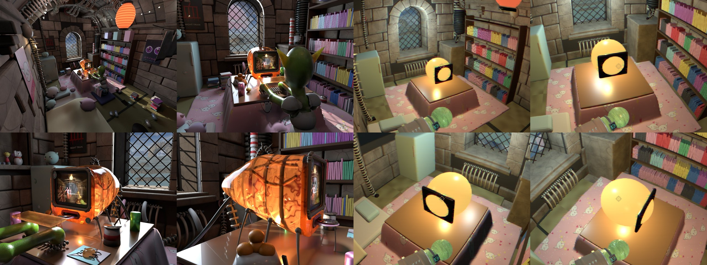
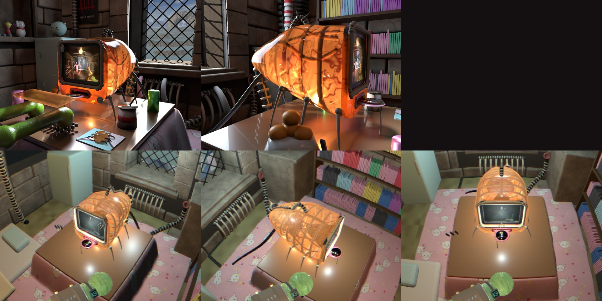

# The Flat's room in the engine: slice 1 (2026-10-11)



`/sdf-game.html?level=flat` (the Esc menu lists it as "The Flat (WIP)"): the last-stage room from the
[2026-10-01 look-dev](../2026-10-01-flat-room-lookdev/notes.md), walkable, built by a Blender script and exported through the level route.
Spec: [2026-10-11-flat-room-design.md](../../superpowers/specs/2026-10-11-flat-room-design.md) · plan: [2026-10-11-flat-room.md](../../superpowers/plans/2026-10-11-flat-room.md).
The owner liked the first pass (2026-10-11) and asked for the Giger iMac next.

## What is in it

- **The stone shell** (`flat/shell.py`): ashlar walls with the stains baked into per-wall textures, the barrel vault with ribs on corbels, the
  window (voussoirs, quoins, lattice, deep reveal) showing the Bryce view on an emissive plane, flagstones, six tatami, the sink counter.
- **The Giger layer** (`flat/giger.py`): vertebral conduits, the turned middle rib, the boiler, the radiator. Three materials.
- **The hero props** (`flat/props.py`): kotatsu and quilt, futon, fridge, bookshelf with books (one material), the paper lantern, the fairy
  lights, the candle, and an amber placeholder where the iMac goes.
- **Four lights**, all `fixture: "none"`: window (cool), lantern, candle, amber (at the iMac's place).

## Numbers (this machine, headless Chrome, a standing player at the start)

| | |
| --- | --- |
| Art | 32 draw primitives, 32 materials, about 298 000 triangles, a 14.4 MB `.glb` (size is not a constraint, owner) |
| Frame | 5 to 7 ms a frame at the start; one noisy run read 13.6 ms. The goal is under 33 ms. |
| Collision | the kotatsu, shelf and fridge each stop the player 0.30 to 0.32 m short (the capsule radius is 0.3) |
| Draw calls | the gate's `drawStats` reads 129, or 0 when it samples between frames: it is flaky, so the budget check is the level test's primitive count and the frame time |

## What differs from the look-dev, on purpose or not

- **No clutter, no goblin, a placeholder iMac** (slice 1's scope).
- **Standing eye (1.75 m):** the look-dev's cameras were low, so the engine shots look down more.
- **Per-block stone tint is gone:** the stone textures are per wall (about 270 to 380 px per metre); the look-dev tinted each block.
- **Lighting is flatter and warmer** (the engine's ambient plus four lights, no raytraced shadows). The stone is tinted neutral to compensate.
- **The bone rings, spines and the radiator** read differently from the look-dev (the cream rings are brighter): the owner says they need work.

## Things learned (all in the commit messages too)

- **The engine steps the player up onto any box under about 0.5 m** (least-penetration push-out), so the kotatsu's collider is 0.9 m tall.
  The futon stays 0.15 m: a cushion you walk over.
- **Level lights get a visible bulb** (0.16 m emissive sphere) unless `fixture` is `none`, a small addition made here (parser test,
  [conventions](../../game/levels/blender-conventions.md)). `shadow` is allowed on tube fixtures only.
- **The quilt, duvet and conduits are the heavy geometry**; an optimisation pass is owed (owner: later).
- **Photographic textures are JPEG** (4:4:4): 9 MB of PNG became 2.9 MB.
- **A module-level materials namespace named `M` collides with the look-dev's local matrices called `M`**: giger.py and props.py call it `MT`.

## Rebuild

```bash
python3 scripts/levels/flat/make_textures.py
blender --background --factory-startup --python scripts/levels/build_the_flat.py
blender --background assets-source/levels/flat.blend --python scripts/levels/export_level.py -- public/assets/levels/flat.level.json
SHOTS=1 bash scripts/sdf-game-flat-gate.sh      # boot, collision, budget, six shots into .lab-tmp/flat/
```

## Next

1. **The Giger iMac**: the translucent amber shell, the screen, the legs (the spec's section 11 item 2).
2. The look of the bone rings, spines and radiator; the optimisation pass; the clutter pass; the goblin at the kotatsu.

## Update: the Giger iMac (2026-10-11)



Spec: [2026-10-11-giger-imac-design.md](../../superpowers/specs/2026-10-11-giger-imac-design.md) · plan: [2026-10-11-giger-imac.md](../../superpowers/plans/2026-10-11-giger-imac.md).
The machine replaces the amber placeholder on the kotatsu: `flat/imac.py`, ported from the look-dev's `giger_imac()`.

**What is in it:** the teardrop shell (an **alpha-blended** glTF material over real guts: seven skull-frame hoops, the keel, the dark neck, vessels, the
curled creature), the face (bone surround, bezel, the sunk screen with a studded lip, the lips and the CD tongue with its disc and drool, gill slits),
the vertebral handle and crest, six beetle legs, and the umbilicus and two hoses to the wall and the floor. The screen shows a captured Night Train frame
(scanlines baked in). Lights: two amber lamps inside the shell and a cool one at the screen.

**What the spike proved:** Blender 5.2 exports a Principled alpha below 1 as `alphaMode: BLEND`; the engine's `fromMaterial` keeps `transparent`/`opacity`;
the dome draws over the guts with correct depth and does not disturb the window plane, the batches or collision. **No loader change was needed.**

**Numbers:** 40 draw primitives (the cap is 60), about 363 000 triangles (the cap is 400 000; the iMac adds about 65 000 over slice 1's 298 000), a 17 MB `.glb` (size is not a
constraint), 5 to 16 ms a frame at the start (the goal is under 33 ms; the gate's reading is noisy on this shared machine).

**Things learned:**
- The look-dev's tubes use a high curve resolution: the first port made the machine 147 000 triangles. `imac.py` has its own coarser `tube` (curve resolution 3, bevel 2).
- **The amber lamps sit 20 to 30 cm from the shell, so the look-dev's powers (14 W and 6 W in Cycles) blow it out here:** 0.35, 0.15 and 0.25 for the screen light, in the layout's units.
- **The look-dev closed the dome with a cap at the face.** A blended, lamp-lit cap sat in front of the dark screen and washed it out to cream, so the cap is not built (the face plate closes the front).
- The shell has a faint emission (the lamp's glow in the plastic) and an alpha of 0.72; the texture's amber is deeper than the look-dev's numbers because the engine's lighting and the blend lighten it.

**What differs from the look-dev (the owner's calls are next):**
- **The shell is paler and its veins fainter**, the guts brighter: the look-dev's Cycles shell is frosted, saturated and blurs what is behind it (transmission), where a blended shell tints it.
  The WGSL shell spike (the spec's follow-up 1) is the route to the frosted, candled look.
- The creature in the guts is hard to make out from the standing eye; the hoops and keel read cream rather than gunmetal.
- The screen is a static frame, dimmer than the look-dev's glowing CRT. No keyboard, mouse or stickers (the goblin-at-the-kotatsu task).

**Tuning knobs** (`flat/materials.py`, `flat_layout.py`): the shell's `alpha` and `emit`; `make_shell()`'s colours and vein widths; the three lamp powers; `make_screen()`'s gamma.
