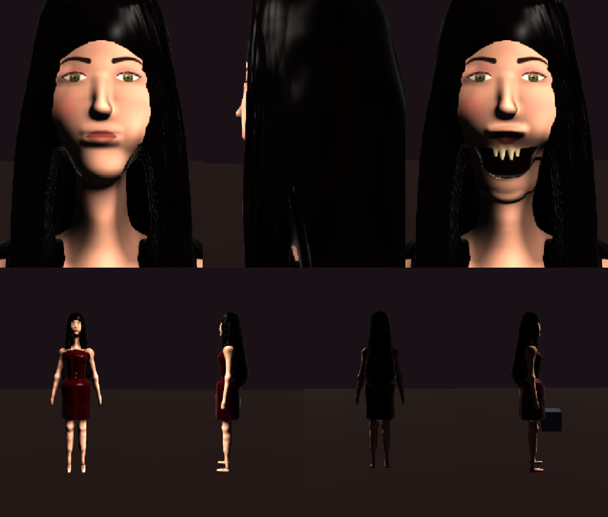
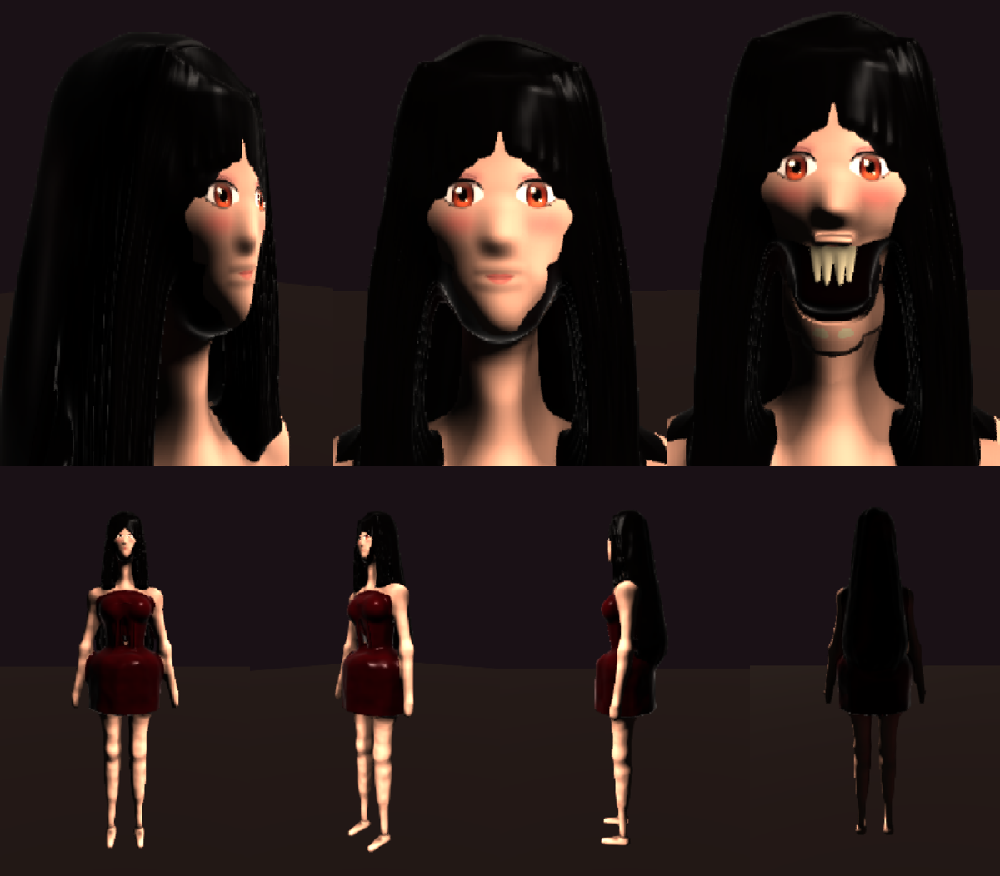
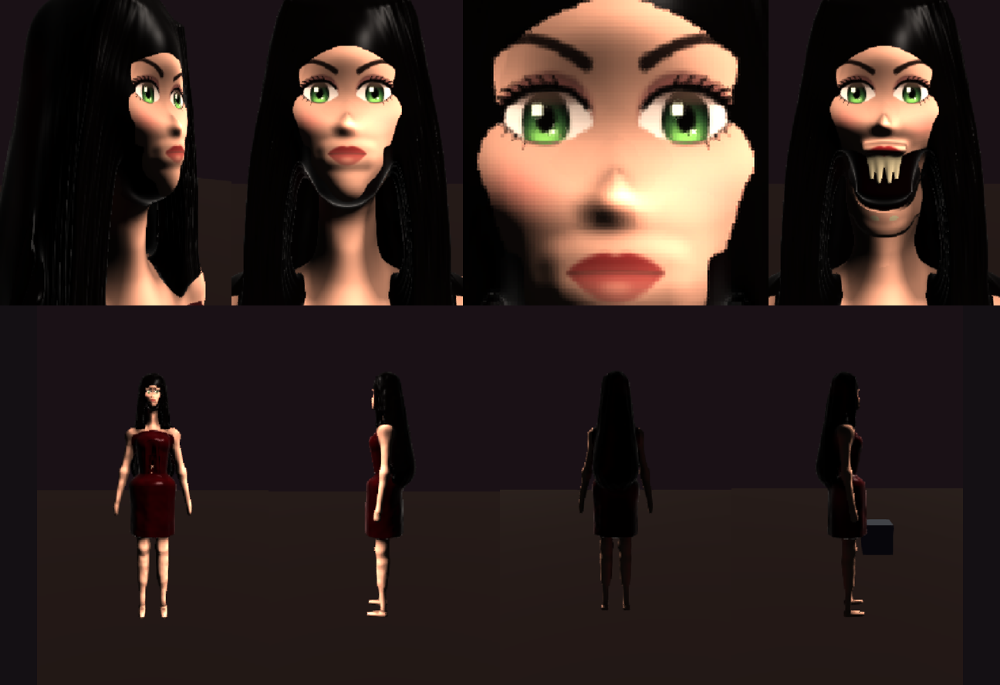

# Siren — first pass (2026-10-23)

The roster's first deliberately beautiful body: a lure. Owner picks: "lure, reveals in motion"; long loose dark
hair; no reference ("you choose").

Top: face at rest, side, and at full gape (0.85 rad, `BLOB_GAPE=0.85`). Bottom: the turntable at yaw 0/90/180/270.

## How she was made

- `characters/siren.blob`: the bride's skeleton and jaw (gait-mappable, the hinge already solved), the head
  softened to a smooth egg, all face colour in `scripts/make-siren-face.py`. See biomech-style.md "Attractive
  characters" for the levers and the dead ends (painted face prims, a bright sheet base, sculpted lids and
  cheekbones, strand planks, hair on the skull).
- The reveal: `SIREN_PROFILE.swingGape` opens the jaw through the zombie mind's unarmed swing
  (`attack.ts` `swingGapeAt`).

## Found on the way

- Long hair or a veil `rigid` on the SKULL swings like a plank in the GAME (the head aims at the player; the lab
  never aims). The bride's veil does it too: in `?spawn=bride` captures it stands out sideways. The siren's fall
  hangs from `spine2` instead.
- `female.blob` (the widow) fails lab validation on main: `armL`/`armR` "disconnected — not fused to any other
  cluster" (`blob:shot -- female` exits FAIL).

## Open

- Her own lunge/bite: the zombie hook bends her double and hides the face at the moment it opens.
- The reveal at a playable distance in game (captures so far are close and the gun covers her face).

## Anime pass (2026-10-23, owner feedback: "too human, needs to be more exaggerated")

References: `anime-3d.glb` and a Mai Shiranui mesh (the owner's ~/Downloads). Third-party characters, so they are
NOT committed and were not baked or measured into the file; read once for proportion (anime-3d: hips 0.23 of height
across over a 0.15 waist; head ~0.12 of height; the face in the lower ~45% of the head). See biomech-style.md
"Anime, not realistic".

## Third pass (2026-10-23, owner: "your previous iteration was better" + "eyes much more anime ... a bit ridiculous big with large lashes", a slimmer pointed face, bigger lips, "the decal doesn't line up with the geometry")

Back to the realistic body and head, with: deep carved eye sockets; huge painted anime eyes (emerald, graded, two
catchlights) with a heavy winged liner and large lash clumps; a smoky prominent upper lid and crease; brows arched and
slanting in; a slimmer face tapering to a pointed chin; bigger crimson lips painted exactly on the lip prims' probed
swells (the old sheet sat 2.3 mm low); the nose tip removed with a painted counter-light under the ridge.

