# Siren — first pass (2026-10-23)

The roster's first deliberately beautiful body: a lure. Owner picks: "lure, reveals in motion"; long loose dark
hair; no reference ("you choose").

Top: face at rest, side, and at full gape (0.85 rad, `BLOB_GAPE=0.85`). Bottom: the turntable at yaw 0/90/180/270.

## How she was made

- `characters/siren.blob`: the bride's skeleton and jaw (gait-mappable, the hinge already solved), the head
  softened to a smooth egg, all face colour in `scripts/make-siren-face.py`. See biomech-style.md "Attractive
  characters" for the levers and the dead ends (painted face prims, a bright sheet base, sculpted lids and
  cheekbones, strand planks, hair on the skull).
- The reveal: `SIREN_PROFILE.swingGape` opens the jaw through the zombie mind's unarmed swing
  (`attack.ts` `swingGapeAt`).

## Found on the way

- Long hair or a veil `rigid` on the SKULL swings like a plank in the GAME (the head aims at the player; the lab
  never aims). The bride's veil does it too: in `?spawn=bride` captures it stands out sideways. The siren's fall
  hangs from `spine2` instead.
- `female.blob` (the widow) fails lab validation on main: `armL`/`armR` "disconnected — not fused to any other
  cluster" (`blob:shot -- female` exits FAIL).

## Open

- Her own lunge/bite: the zombie hook bends her double and hides the face at the moment it opens.
- The reveal at a playable distance in game (captures so far are close and the gun covers her face).

## Anime pass (2026-10-23, owner feedback: "too human, needs to be more exaggerated")

References: `anime-3d.glb` and a Mai Shiranui mesh (the owner's ~/Downloads). Third-party characters, so they are
NOT committed and were not baked or measured into the file; read once for proportion (anime-3d: hips 0.23 of height
across over a 0.15 waist; head ~0.12 of height; the face in the lower ~45% of the head). See biomech-style.md
"Anime, not realistic".

## Third pass (2026-10-23, owner: "your previous iteration was better" + "eyes much more anime ... a bit ridiculous big with large lashes", a slimmer pointed face, bigger lips, "the decal doesn't line up with the geometry")

Back to the realistic body and head, with: deep carved eye sockets; huge painted anime eyes (emerald, graded, two
catchlights) with a heavy winged liner and large lash clumps; a smoky prominent upper lid and crease; brows arched and
slanting in; a slimmer face tapering to a pointed chin; bigger crimson lips painted exactly on the lip prims' probed
swells (the old sheet sat 2.3 mm low); the nose tip removed with a painted counter-light under the ridge.

## Fourth pass (2026-10-23, owner: chin too big, mouth juts out, lips bigger, nose and lower face closer to the eyes, eyes "too tight", heavier liner and lid; then "a crease under the nose" and "the open mouth is all messed up")

Smaller, higher, receded chin; mouth pulled back (the face-mass blends had swollen it into a muzzle); nose, mouth and
jaw hinge (`hinge=0.32`) moved up; bigger lips; eyes opened (26 mm tall); 3-4.5 mm liner with a 12 mm wing and an
8-10 mm smoky lid. The crease was a degenerate tapered jaw capsule (a real 1 mm step in the field); the open mouth
now opens right under the red upper lip onto fangs and a deep red gullet.

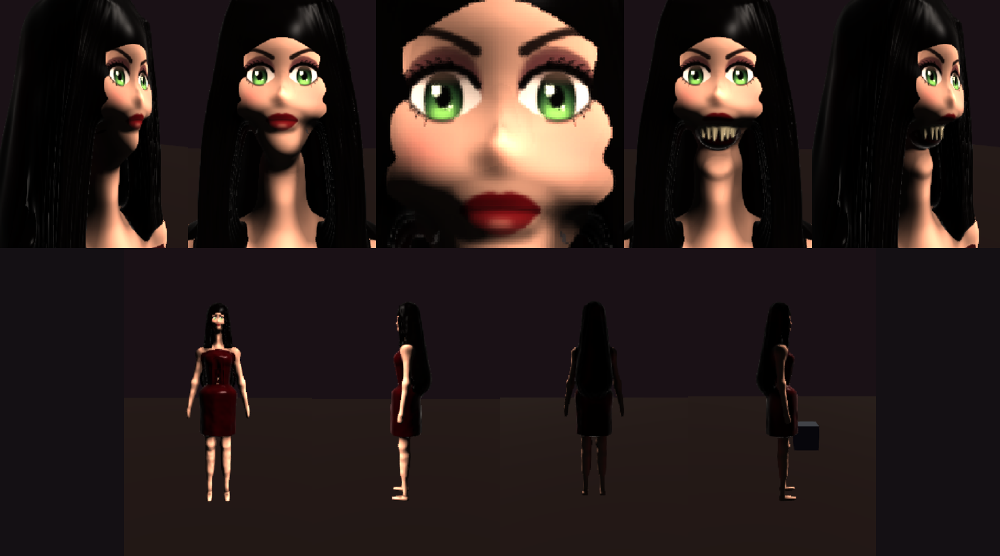

## Fifth pass (2026-10-23, owner: "her open mouth doesn't look right"; "change her hair to blue and tie it into two pointy buns")

The open jaw: at 0.85 rad its rotation about a hinge behind the mouth swung the whole lower face back into the neck,
leaving a fanged hole over a bare throat. `swingGape` 0.6; the lower lip carries its red on the jaw so it drops with
it; lower fangs lengthened to clear the jaw mass. Hair: cobalt (2448b8), crown mass + two round buns with points +
short sidelocks + a back mass; the long fall removed.

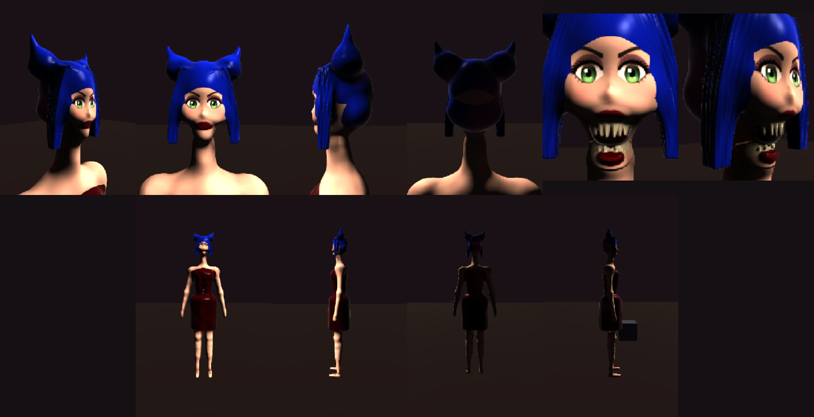

## Sixth pass: the bare body (2026-10-23, owner: "are her clothes painted on? ... focus on body first without attachments ... more like the venus character with the rear and chest though bigger and bustier but without all the bumpy texture")

The dress (two shell layers plus a crimson-painted bust) removed. Torso and legs rebuilt on venus's lines: hips ~0.16
half-width carried out to ~0.21 by the thigh tops, a rear of two round mounds, a waist pulled to ~0.10, a big round
bust; thighs heavy at the top tapering to a slim knee (thigh side 0.105, arms out to tilt 20 to clear the hips). The
"bumpy texture" was `silhouetteNoiseAmp` 0.008, which DISPLACES the surface: now 0, as is `surfaceNoiseAmp`.

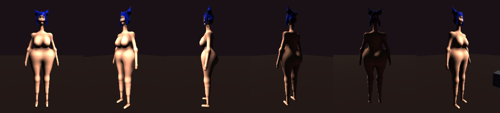

## Seventh pass: belly and pelvis (owner: "her abdomen from the front is weird, doesn't read as a proper belly and pelvis region")

Measured, not guessed (half-width and front z down the centreline, arms removed): there was no waist under the bust —
0.128 half-width at y 1.20 but 0.216 by 1.10 — because the thigh bar started at the hip joint and its r 0.108 end
cap rose to y ~1.14; and the pelvis ellipsoid stood 5 cm proud of the waist (a pot belly). Now the thigh bar starts
at 0.16 of the thigh, the pelvis is a downward-tapering cone (r 0.128 -> 0.066) narrowing to a V between the thighs,
set back, with a soft lower-belly swell: waist 0.108 at y 1.15, hips 0.238 at 0.95, belly ~2.5 cm proud.

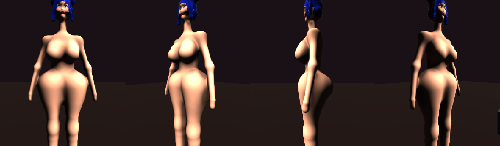

## Eighth pass: the 1940s pin-up face (2026-10-24, owner: "more resemble Jessica Rabbit ... the eyelids are really big and long lashes, eyes are not so wide open though eyes are big")

The archetype, not the character (a Disney/Amblin IP): the upper lid's EDGE drops to 40% of the eye's height
(`LID_OPEN`), so the lid covers the top ~40% of a big iris and the eye is half-closed; above it to the eye's full top
is a lavender-pink lid with a soft highlight across its middle and a plum crease; five long lashes sweep OUT from the
outer half (a row standing up across the lid read as a comb); thin high brows (inner ends dropped low read as an
angry V); a fuller, pouty cupid's-bow mouth. Also a navel (a groove pit) and a belly mound in front of recessed thigh
tops.

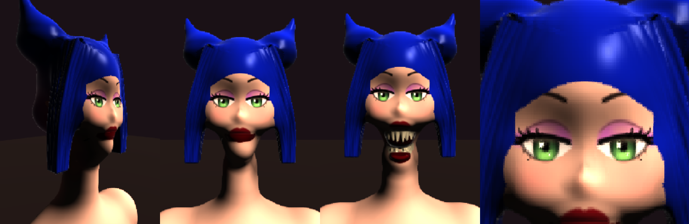

## Ninth pass: long orange hair (2026-10-24, owner: "change her hair to be long orange hair like the reference")

Orange (e8661c; d2461a rendered plain red under the warm key), side-parted with a volume swell on the part side, a
glossy swoop rolling over her right brow and down the side of the face OUTSIDE the eye (a strand lock run diagonally
across the eye read as a band over the face), curtains to the collarbones, a back mass, and the long fall back on
`spine2` (r2 0.135: at 0.170 it was the nearest prim to the shoulder tops and painted them orange). Still a little
helmet-like from the front.

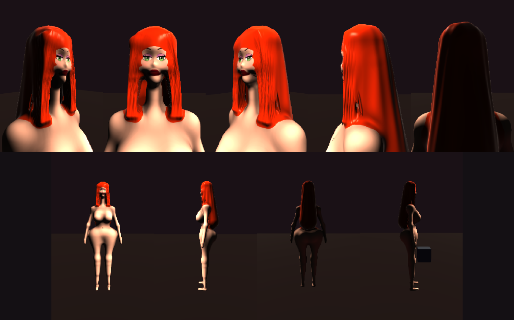

## Tenth pass: twin tails, wider-set eyes, smaller cheeks (2026-10-24, owner: "maybe like double ponytail with long tails ... the eyes may be too close, cheeks too big")

Long fall and curtains removed; two high ties (x +-0.080, y ~1.81) with a dark band and a 0.38 m tapered strand tail
each, falling out, down and BACK behind the shoulders (straight down they hung like side curtains and painted the
shoulder tops). Eyes 3 mm further apart each (sheet `EYE_IN/OUT`, `IRIS_X`, the brows and the socket carves together);
cheek prims r 0.022 -> 0.017, the face mass wide 1.06 -> 0.98.

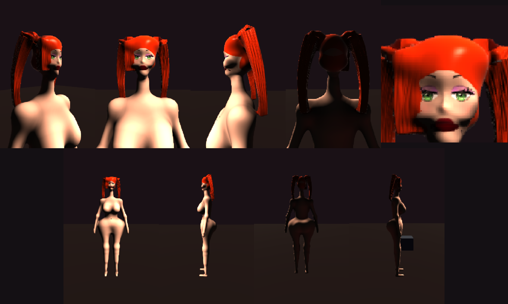

## Eleventh pass: a bouffant, a nose that projects (2026-10-24, owner: "a big bouffant blowout type deal ... her nose should project more")

Twin tails out. The bouffant is several big masses (a teased crown, sides, back, flipped ends at the jaw) each with
radius x largest scale under the cranium's 0.0912, so the face sheet keeps projecting off the skull. The nose had never
projected because the eye-socket CARVES' smooth blend ate the bridge along its whole length (prim inside, body
outside); carves narrowed (wide 0.90, blend 0.004, x 0.033) and the ridge's end pushed 8 mm out: ~1.3 cm proud.

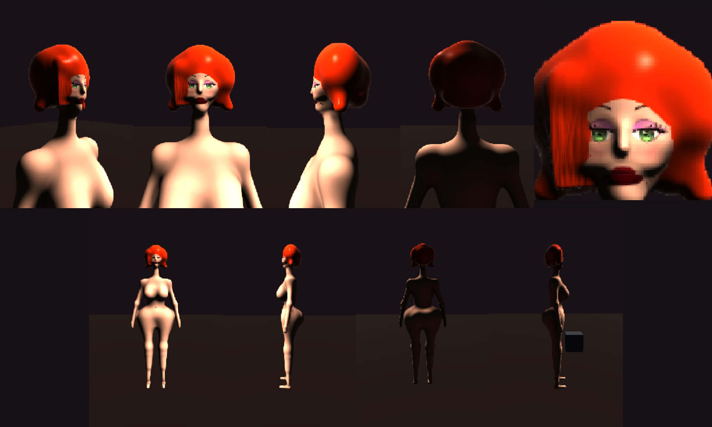

## Twelfth pass: a flapper bob (2026-10-24, owner: the bouffant "looks quite asymmetrical ... maybe like a betty boop style stylized short haircut")

The 1930s cartoon flapper archetype, not the character: symmetrical, a centre part between two round lobes, a widow's
peak, short at the jaw with the ends flipped up, two flat spit curls on the forehead. Curls standing OUT round the
silhouette were tried twice (thin, then fat): in 3D they read as a spiked mace. A cartoon's curls are drawn flat on
the hair.

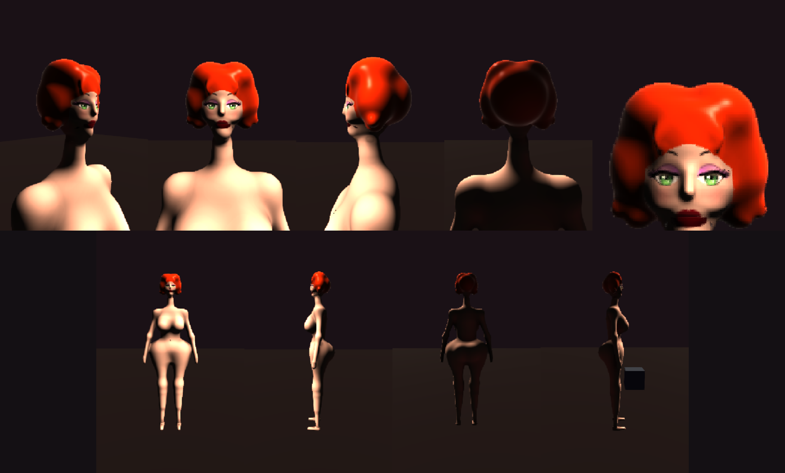

## Thirteenth pass: a bustier and skirt (2026-10-24, owner: "a bustier and skirt ... mesh or sdf, I'll let you decide")

SDF shells, fitted to probed body cross-sections (half-width and front/back z, y 1.42 -> 0.60, arms removed), crimson
satin: a cup shell per breast cut at y 1.31; a ribbed bodice cone from the waist to under the bust; the upper skirt an
ELLIPSOID shell on the pelvis (the hips' dome below the waist — x 0.114 / 0.178 / 0.218 / 0.244 at y 1.12 / 1.08 /
1.04 / 0.96 — which no cone follows; its top closes inside the waist, so there is no band); the lower skirt a pencil
cone on the hem pendulum to y 0.71. The upper shell is cut low (0.84) so it sinks inside the pencil rather than ending
in a ledge at the seam. Coverage checked on the CPU from front/side/back: no skin through. In the walk the thigh
comes out under the hem, not through it.

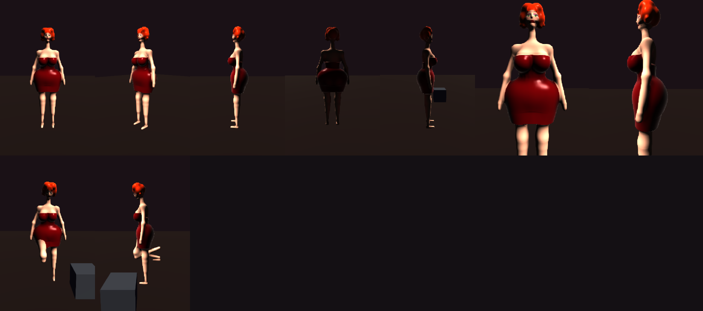

## Fourteenth pass: proportions and the walk (2026-10-24, owner: "her neck is a bit too long, her thighs are a bit too wide such that her arms fuse into it ... we should fix her motion profile as well")

Neck 0.14 -> 0.10 m (the bride's was her deliberately-wrong stalk). Hips 0.244 -> 0.228 half-width (thigh masses and
the pelvis narrowed), the skirt refitted. The arm/hip fusion was MEASURED (arm surface to body surface below the
armpit): the forearm ran 1 cm into the hip; splaying wider only put the hand at the hips' widest point, so the
forearms come forward (upperarm 24 / 6, forearm 12 / 30): 3.7 cm clear, ~2% of height. The back-kick in the walk:
STALK's legs are the soldier's walk CLIP, and in curve mode the knee bend is the clip's own (strideLen and cadence do
not touch it) — on her long legs it folded the swing shin to the horizontal, ankle 0.45 m up at 1 m/s. SIREN_WALK is
now parametric (shamble machinery: lift 0.08, knee 0.06, 1.0 Hz x 0.42 m sized to a 0.85 m/s cruise): the swing ankle
peaks at ~0.16 m. The bride shares the same mismatch (her armour hides it).

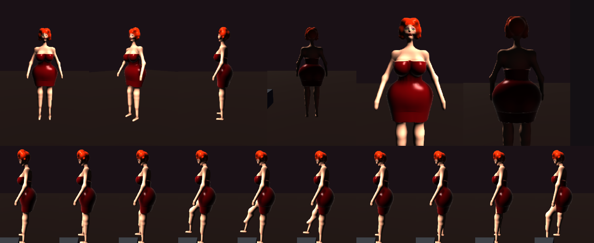
