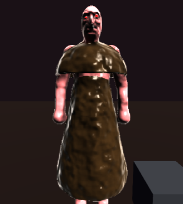
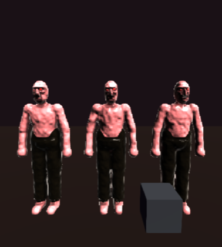
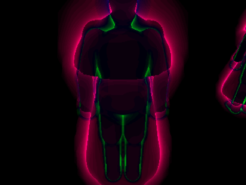
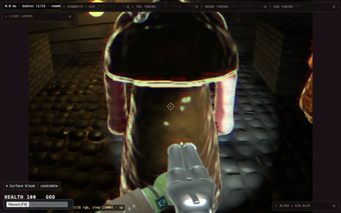
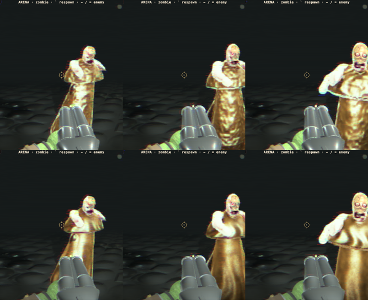
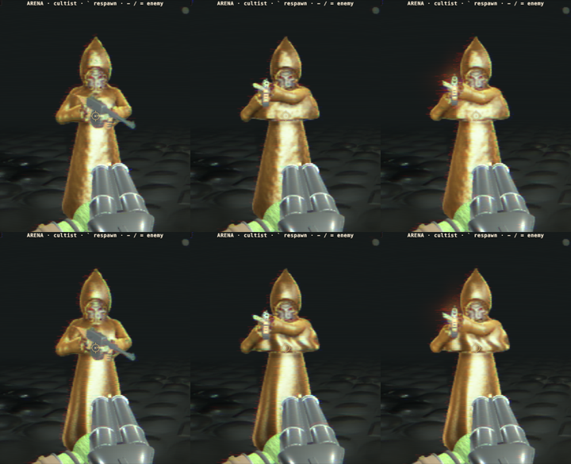
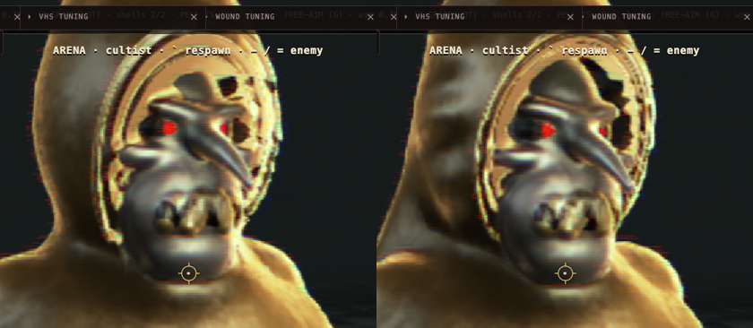
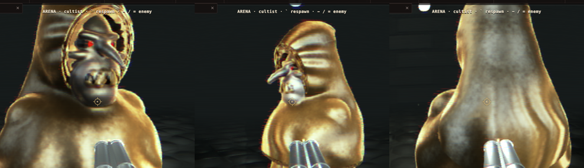

# SDF cloth on a crowd enemy: what it costs, and how to make it cheaper (2026-10-26)

The question (owner, after the zombie's trousers moved from polygon kit to paint in goblincore/blud#82): could the
zombie wear **real SDF cloth** (trousers, or a robe like the cultist's) instead of paint, and what would it cost?
The owner's bar for the cultist was **about 1.5x a zombie**.

**Short answer** (updated by the follow-up below: the rasterised cloth proxy brings the robe to 1.64x).

- **Trousers and anything else that hugs a limb:** do it as an **offset of the flesh**: paint, plus the covered
  prims' radius grown by the cloth's stand-off. It costs **1.00-1.01x**. SDF shell tubes cost **1.48x** in close-up
  and buy an air gap nobody sees at game range.
- **A robe, skirt or hood that leaves the body:** a shell is the only option, and it costs **2.07x** a zombie in
  close-up and **1.30x** in the arena. That is over the 1.5x bar where it matters (close-up). The cost is **steps**,
  not prims, and most of it is rays near the robe's silhouette.
- **Prototype landed:** a taper-aware outer-hull chain (−7% on the robe close-up, engine-wide, conservative, tested).
  The other levers measured small or are already in place by construction.

## How it was measured

- **Garments**: `webgpu/bench-cloth.ts` rewrites `zombie.blob` into five variants, so only the cloth changes:

  | Variant | What it is |
  | --- | --- |
  | `paint` | #82's labourer trousers: `color=` on the thigh and shin bars and the pelvis mass |
  | `offset` | paint, plus those bars' `r` grown by 12 mm (lever b) |
  | `trousers` | paint, plus five shells: a seat, a tube per thigh, a tube per shin open at the ankle |
  | `robe` | the cultist's skirt (on a `hem` pendulum) and capelet, legs painted |
  | `robe-flat` | the same robe with no `warp=` folds |

  `?cloth=<variant>` selects one on both `sdf-bench.html` and `sdf-game.html` (dev only).
- **Counters, not clocks.** The machine sat at a load of 8-170 for the whole session. So every result below comes
  from the march's own debug counters, read off the float march target: debug mode 13 is the ray walk (misses
  included), mode 14 the whole pixel. They are **deterministic**: repeat boots gave identical counts on both pages.
  - **walk** = prim evaluations while marching.
  - **shade** = prim evaluations after the hit (normal taps, AO).
  - **total** = both. This is the work the GPU does.
- **Bench**: `scripts/cloth-cost.mjs`, scenes `Z1` (one zombie at 1.3 m, new) and `CZ` (three at 2.2 m). The bench
  page has **no outer hull**, so every background ray walks the whole proxy box. That inflates miss costs.
- **Game**: `scripts/cloth-cost-game.mjs`, seeded and frozen, the page as it ships (crowd march, hulls, kit
  occluder). Two stages: `close` (room 4's nearest zombie, eye 1.3 m from its chest) and `arena` (room 6, as
  `teleport` leaves it: 8 bodies in view, incl. non-zombies).
- `DUMP=1` on either script writes the raw mode-13 texels, for a per-texel diff between variants.

 

## Numbers

### Game: the result that counts (prim evaluations per frame, M = million)

| Variant | close: steps | close: walk | close: shade | close: **total** | x zombie | arena: **total** | x zombie |
| --- | --- | --- | --- | --- | --- | --- | --- |
| none (zombie) | 0.13 | 1.41 | 1.66 | **3.07** | 1.00 | **0.51** | 1.00 |
| paint | 0.13 | 1.41 | 1.66 | **3.07** | 1.00 | **0.51** | 1.00 |
| trousers (shells) | 0.13 | 2.00 | 2.54 | **4.54** | 1.48 | **0.59** | 1.16 |
| robe | 0.41 | 4.54 | 2.24 | **6.78** | 2.21 | **0.68** | 1.33 |
| robe-flat | 0.32 | 3.97 | 2.34 | **6.31** | 2.06 | **0.65** | 1.27 |
| *taper-aware hull (prototype):* | | | | | | | |
| none | 0.13 | 1.41 | 1.66 | **3.06** | 1.00 | **0.50** | 1.00 |
| trousers | 0.13 | 2.00 | 2.54 | **4.54** | 1.48 | **0.59** | 1.18 |
| robe | 0.36 | 4.08 | 2.24 | **6.33** | 2.07 | **0.65** | 1.30 |
| robe-flat | 0.28 | 3.49 | 2.35 | **5.84** | 1.91 | **0.61** | 1.22 |

The arena ratios are for the **whole room's** march: 8 bodies, only some of them zombies. They dilute the
per-zombie cost and show what a mixed crowd would pay. `offset` was not run on the game page. On the bench it is
+1% (below), and it adds no prim.

### Bench (no outer hull; totals in M prim evaluations)

| Variant | Z1 steps/px | Z1 total | x | CZ total | x |
| --- | --- | --- | --- | --- | --- |
| none | 13.41 | 14.98 | 1.00 | 8.39 | 1.00 |
| paint | 13.41 | 14.98 | 1.00 | 8.39 | 1.00 |
| offset | 13.44 | 15.14 | 1.01 | 8.53 | 1.02 |
| trousers | 12.80 | 17.29 | 1.15 | 10.41 | 1.24 |
| robe | 19.66 | 18.89 | 1.26 | 9.37 | 1.12 |
| robe-flat | 17.27 | 18.27 | 1.22 | 8.99 | 1.07 |
| robe, warp far bound (reverted) | 18.49 | 18.70 | 1.25 | 9.26 | 1.10 |

### Where the robe's cost lands (game close-up, per-texel diff against the bare zombie, taper-aware hull)

| Texels (zombie → robe) | Count | Steps/px | Prims/px | Extra walk prims |
| --- | --- | --- | --- | --- |
| not marched → marched and **missed** | 17,044 | 0 → 7.4 | 0 → 73 | **1.24M (46%)** |
| hit → hit (the robe in front of the legs) | 26,318 | 2.7 → 4.6 | 29 → 58 | 0.76M (28%) |
| not marched → hit (the robe's new silhouette) | 5,987 | 0 → 6.8 | 0 → 61 | 0.37M (14%) |
| missed → missed / hit → missed | 3,463 | ~5 → ~13 | ~50 → ~156 | 0.37M (14%) |

Before the taper-aware hull, the first row was 22,360 texels and 1.53M. The diff image is below. Red is extra
steps: a wide ring of marched-and-missed texels round the robe, and slow rays along its silhouette.

 

### Timing (not trustworthy this session)

`__sdfGame.timeDraws(40)` ran at a load of 10-20. The same leg (close, bare zombie) read 28.4, 45.3 and 48.9 ms on
three boots. The robe close-up read 44.5, 66.2 and 85.1 ms against those. That agrees in direction with the
counters, but no ratio can be quoted from it. Re-time on a quiet machine with
`ROUNDS=4 node scripts/cloth-cost-game.mjs`, and treat the counter ratios above as the expectation.

## The levers, one by one

### (a) Fold a shell only where a ray is near it: already true, and the hull was the loose part

- `pack.ts boundGroups` already gives **every shell its own one-prim bound group**, culled per step by its sphere.
- That sphere is loose for a long cone (the skirt's is r = 0.77 m). But it costs at most one prim per step, and
  **prims per step barely move** with cloth. In the game close-up: zombie 10.8, robe 11.3. The cost is in steps.
- The loose bound that **did** matter is the **outer hull**. `shell-hull-outer.ts` chained spheres of the prim's
  **max** radius along its whole axis. For the skirt (0.15 → 0.32 m) and the capelet (0.08 → 0.285 m) that is a fat
  tube round the thin end: it marches texels where nothing can be hit.
- **Prototype (landed in this PR): `taperedChain`.** A round cone is the convex hull of its two end balls, which is
  exactly the union of the balls with linearly interpolated centre and radius. So each segment of the chain only
  needs the larger of its two end radii, and the header's capsule proof applies segment by segment.
  - **Conservative:** new tests ray-trace a 0.05 → 0.30 m cone and the robe and trousers zombies for containment.
  - **Effect:** the cone's hull is 54% of the old volume. The robe close-up: marched texels 63.9k → 58.6k, walk
    4.54 → 4.08M, total −7%. Arena −4%.
  - It helps every tapered straight prim, and the bare zombie moved by 0.01M.
- **Not done, and the next lever if a robe must ship:** a hull that fits a cone better than spheres do.
  - The ring of marched-and-missed texels is still 46% of the robe's extra walk. It is the chain's 13% inflation plus
    its scallops, over a 0.6 m wide silhouette.
  - A cone or frustum hull piece per shell (two caps and a side, rasterised like the spheres) would bound it to
    millimetres.
  - The upper bound on what it returns is that 1.24M of 6.33M, about **20% of the robe close-up**. That would put
    the robe zombie at about 1.7x.

### (b) Cloth as an offset of the flesh: free, for cloth that follows a limb

- `offset` is paint plus the covered bars' radius grown by the stand-off. It adds no prim and costs **+1-2%**, all
  of it from the slightly fatter silhouette.
- The five-shell `trousers` cost **1.48x in close-up** for an 8 mm sheet over an air gap the camera never sees.
  - Their **shading** cost rises the most (+53%, 1.66 → 2.54M). `calcNormal`'s taps and the AO probes call
    `mapBody` with **no upper bound** (PERF.md, cultist pass: "Next 2"), so every tap folds the shells' big spheres
    as well as the flesh.
- What the offset cannot do:
  - a **hem lip** (cloth edge standing off the skin);
  - **folds** (`warp=` is shell-only: `blob-compile.ts` throws on a non-shell);
  - **swing**.
- **Cheap engine extensions,** if the look needs them (not built):
  - **a per-prim CUFF:** `d = d_flesh - stand-off x step(clip plane)`, the step smoothed over its own width and the
    result divided by `1 + stand-off / width`. That is a hem lip from the same fold, with no prim added.
  - **`warp=` on painted flesh:** folds on the leg surface, paid only by the prims that carry it.

### (c) Flesh under opaque cloth never marched: true for SDF cloth by construction

- The march stops at the **first** surface: a ray that hits the robe never marches the legs behind it. The legs'
  groups are culled while the ray approaches, by the upper-bound cull (`gCullRef`), because the cloth is nearer.
- That is why prims per step **fall** on the bench robe: 7.68 → 6.51 on Z1.
- The kit occluder (#83) solved a problem SDF cloth does not have: polygon cloth is invisible to the march, so the
  march used to walk to the flesh behind it.
- The one place the idea would still pay is **shading**. A hit on cloth still runs flesh-path shading taps without a
  bound. That is the general "bound the shading taps" item, and it would cut the trousers' +53% shading for every
  character.

### (d) Fewer, larger shells, and a cheaper hem

- **Fewer, larger shells: no.** Each shell is already one group, and merging them would make the bounds looser. The
  robe is two shells and still costs 2x, so count is not the problem.
- **The hem pendulum is free on the GPU.** It is a Verlet rig point on the CPU, and the skirt rides it rigidly.
- **The rim** is one `length()` per shell fold. Nothing to win.
- **`warp=` folds** are the only real hem cost: robe vs robe-flat is **+8% total, +29% steps** in the game close-up
  (+3% total on the bench).
  - **Tried and reverted: a far-field bound.** `|dBase| - |A| - thick` is 1-Lipschitz, so it can replace the
    `/lip` divide away from the sheet and skip the three sines. It recovered about half the warp's extra steps
    (bench Z1 steps 19.66 → 18.49), but only −1% total.
  - It broke `shell-warp.test.ts`'s over-relaxed tracer gate: relax 1.4 times a tight bound steps clean over an 8 mm
    sheet.
  - The game ships `GAME_RELAX = 1.0`, so it could be revived behind a "not relaxed" flag. It is not worth it for 1%.
  - If folds are kept, keep `warpA x |warpFreq|` small: `lip` divides every step near the cloth.

## Option 1, built: the rasterised cloth proxy (follow-up, same day)

`webgpu/cloth-proxy.ts` gives each straight shell prim a **closed triangle mesh fitted to its own round cone**.

- **Size.** The cone is grown by the shell's reach (thickness, warp, blend, noise, margin), plus a second blend
  reach for the chained-blend case, then circumscribed so the flat facets still contain it.
- **Drawing.** `shell-hull-outer.ts` draws these meshes into the outer hull's entry and exit targets, as children of
  the sphere meshes with the same two materials, **in place of** that shell's sphere chain. Rays start a few
  centimetres from the cloth, and a pixel the cloth does not cover is not marched for it.
- **Toggle.** `?clothproxy=0` turns it off for A/B.
- **Scope.** Bent shells, and bodies with a split head, keep their sphere chains. Up to 256 shells; past that, every
  shell falls back to spheres.

**Containment** is pinned three ways:

- **The mesh alone** (`cloth-proxy.test.ts`): it is convex and wound outward. Every sampled point of its true round
  cone lies inside every face plane, for a skirt, a capelet, a trouser tube, a ball and a degenerate cone.
- **Whole bodies** (`shell-hull-outer.test.ts`): rays fired at the robe zombie, the trousers zombie and the shipped
  **cultist** (skirt, capelet, cuffs, hood). Every first hit is inside a hull sphere or a proxy.
- **Why the second blend reach.** The first version escaped by **4.9 mm** at the trouser crotch and knees. There,
  two shells and the flesh between them blend within each other's reach, and their smin undercuts stack. The
  sphere chain's 13% inflation used to absorb that case; a fitted mesh has no spare room.

**Game counters** (proxies on, against `?clothproxy=0`, which is the taper-aware chain above):

| Variant | close: steps | close: walk | close: **total** | x zombie (3.06) | arena: **total** | x zombie (0.50) |
| --- | --- | --- | --- | --- | --- | --- |
| robe, spheres | 0.36 | 4.08 | **6.33** | 2.07 | **0.65** | 1.30 |
| robe, **proxy** | 0.24 | 2.74 | **5.01** | **1.64** | **0.59** | **1.18** |
| robe-flat, spheres | 0.28 | 3.49 | **5.84** | 1.91 | **0.61** | 1.22 |
| robe-flat, **proxy** | 0.19 | 2.36 | **4.73** | **1.55** | **0.57** | **1.14** |
| trousers, spheres | 0.13 | 2.00 | **4.54** | 1.48 | **0.59** | 1.18 |
| trousers, **proxy** | 0.13 | 1.88 | **4.41** | 1.44 | **0.58** | 1.16 |

- **Robe close-up: −21% total, −33% walk, −33% steps.** Together with the taper chain, that is −26% against where
  the spike started (6.78M).
- **Rendering is unchanged.** Per texel against spheres, no texel the old hull marched goes unmarched. Robe hits
  drop from 5.1 to 4.3 steps each. Only 8-10 grazing silhouette texels flip between hit and miss, both ways, as
  moving a ray's start point does to an edge pixel.
- **Shading is unchanged** (2.24 → 2.27M). Shading is now the larger half of the robe's cost: it is untouched by
  any hull and is the next lever.

**Timing** is indicative only: load was 10-22. The A/B used three boots per mode, each timing the robe close-up and
the bare zombie close-up with `timeDraws(60)`, read as robe minus zombie *within the same boot*:

| | Boot 1 | Boot 2 | Boot 3 |
| --- | --- | --- | --- |
| proxy: robe / zombie | 59.9 / 50.5 ms (+9.4) | 39.1 / 30.6 ms (+8.5) | 35.2 / 25.9 ms (+9.3) |
| spheres: robe / zombie | 41.1 / 30.1 ms (+11.0) | 50.2 / 30.1 ms (+20.1) | 42.5 / 24.0 ms (+18.5) |

The robe's extra frame time falls from ~11-20 ms to ~9 ms, which agrees with the counters. Re-time quietly before
quoting it.

## The shading lever (follow-up 2)

**Finding: shading is not a cloth cost.** Shading prims per hit pixel in the game close-up are the same for cloth
and flesh:

| | Shading prims per hit pixel |
| --- | --- |
| zombie | 61 |
| robe | 60 |
| trousers | 86 |

- The robe's shading total is higher only because it covers more screen.
- The trousers' extra is the four normal taps folding tube and flesh together.
- So no shading change moves the cloth-to-zombie ratio. These are **general** levers, for every character.

Two spike switches measured, both **off by default**, with the shader text byte-identical when off:

- **`?shadebound`**, the post-hit upper-bound cull (`march/shade-bound-flag.ts`, `map-body.wgsl.ts`,
  `trace.wgsl.ts`).
  - The walk already gives every sample's fold an upper bound, so the culls bite from the first cluster. The
    shading's `mapBody` calls (normal taps, AO and scatter probes, wound shadow) had none.
  - The walk now leaves its accepting sample's fold, point, slot and piece behind. Every later `mapBody` of the pixel
    culls against `fold + 3 x |p - sample| + 2 mm`, the walk's own rule.
- **The analytic normal off** (`__sdfGame.setNormalGradient(0)`, a runtime switch that already exists).
  - Debug mode 12 says `ngBody` reports reason 1 ("unsupported") on **every** hit pixel of both scenes: zombie, robe
    and the arena's whole cast.
  - It gives up on ANY tapered or shaped prim, including prims in groups it merely skips (`ngExcluded` checks
    those). The zombie's foot bar is tapered, and every shell is shaped.
  - So each hit pays `ngBody`'s fold and then the 4-tap fallback anyway. `?ngcount` adds `ngBody`'s own prim
    evaluations to the census, which never saw them.

| Game counters (with `?ngcount`) | close none | close robe | close trousers | arena none | arena robe |
| --- | --- | --- | --- | --- | --- |
| A. as shipped | 3.21 | 5.13 | 4.54 | 0.54 | 0.62 |
| B. analytic normal off | 3.06 (−5%) | 5.01 (−2%) | 4.41 (−3%) | 0.50 (−7%) | 0.59 (−5%) |
| C. B + post-hit bound | 3.00 (−7%) | 4.95 (−4%) | 4.33 (−5%) | **0.44 (−19%)** | **0.54 (−13%)** |

Pixels (the shaded float march target, max channel difference over hit texels):

| | A → B | B → C |
| --- | --- | --- |
| robe | bit-identical | max 27/255; 22 texels > 1/255 |
| trousers | bit-identical | max 15/255; 41 texels > 1/255 |
| bare zombie | max 9/255; 11% of texels > 1/255 | max 8/255; 18% of texels > 1/255 |

- The bare zombie's A → B difference contradicts mode 12's "always reason 1". The analytic path reaches the bare
  body's image somewhere (a side effect of its globals?), so it needs a look before it is switched off.
- The bound's shifts are the smin-order kind the walk's own bound made when it landed (max 11/255 then). The
  robe's few outliers up to 27/255 would need an owner look.

**Verdict.**

- **Worth taking for CROWDS**, where it is −13% to −19% of the arena's march work. In close-up it is only −4% to
  −7%.
- **Order:**
  1. the post-hit bound, after an owner look at the outliers;
  2. the analytic normal: either fix `ngBody` so it skips unsupported prims it does not need (instead of failing
     the whole pixel), or turn it off where it can never succeed. That needs the bare-zombie difference understood.
- **Close-up shading** is about 4 taps x ~12 prims + an AO probe per hit pixel. The 7 cm cull margin (4 x the
  blend) keeps most nearby groups in. The next lever there is fewer taps or cheaper ones, not culling: for example,
  normals from the walk's last two samples, or a 3-tap one-sided difference.

## Cloth that reads as cloth (follow-up 3)

**The owner's verdict on the robe zombie:** "it doesn't really feel like cloth, it's just like SDF flesh in terms of
how it moves and looks". The cause was that shells were lit exactly as skin is:

- subsurface scatter;
- the wet glint;
- skin pore and silhouette noise in the normal;
- a hard terminator.

They also had no visible folds (the field's `warp=` folds are 1 cm and lost at game range). And in the game they
were frozen to the body: only the lab ever set `windDrift`.

**Changed.** A painted `shell` prim (shape bit 4, read off the texel the painted branch already loads) is now
**cloth** in the shading:

| Where | What cloth gets |
| --- | --- |
| `shading-normal.wgsl.ts` | no skin noise in the normal |
| `paint-char.wgsl.ts` | a rest-frame dye mottle (long streaks plus a fine slub) |
| `wet.wgsl.ts` | the wet highlight at 12%, except inside a hole, where the flesh under it keeps its own |
| `occlusion.wgsl.ts` | no subsurface scatter |
| `light.wgsl.ts` | a wrapped terminator (+0.25) |
| `compose.wgsl.ts` | a grazing sheen, 0.4 x (1 - N.V)^3 in the cloth's colour |

**Folds, shading-only** (`shading-normal.wgsl.ts`, CLOTH FOLDS):

- Nine pleats round the hit shell's own rest axis, deepening toward its open end and wandering a little.
- They tilt the normal and darken the fold floors in the paint (`clothValley`).
- **Motion.** `zombie-gpu.ts setRootShift` now lags the shell folds' lattice by `CLOTH_WALK_DRIFT` (0.35) of every
  step the body takes. The field's warp folds therefore stream back through the cloth as it walks, and a wave
  (driven by the walked distance) runs down the shading pleats. Jumps over 0.5 m (spawn, teleport) are not steps.

**Cost: zero march work.** Census before and after is identical: close-up 3.06M zombie and 5.01M robe; arena 0.50M
and 0.59M. Everything is per-cloth-pixel arithmetic plus two texel reads.

**Pixels:**

- **Robe:** changes as intended.
- **Bare zombie:** an A/A of two boots of the old code is bit-identical. Before → after moves the zombie by a
  **mean of 0.6/255**, max 6.6/255, with no net brightening or darkening, spread thinly over the whole body.
- No non-cloth path computes anything different (every use is `if (cloth > 0.0)` or a multiply by 1 - 0), so that
  is the shader compiler's code generation shifting, not a logic change.

**Frames** (arena, the enemy walking at the player). Top/left is before, bottom/right is after:

Clips: [robe](look-robe-before-after.gif) and [cultist](look-cultist-before-after.gif).

**Not done; the next steps for feel:**

- The skirt still swings as ONE rigid cone on the `hem` pendulum. The gait already supports a chain (`hem2`/`hem3`)
  that `.blob`s can use for a bending hem.
- Folds react to walking but not to turning (the lattice is body-anchored by yaw).
- The colour is the owner's: tan 6e5c40 still reads gold under the flashlight.

## The hood as cloth, and the shell-edge artefacts (follow-up 4)

**The owner's live look:** the look was "promising" but not apparent enough, with four problems:

- the robe zombie's legs clip through the skirt;
- "onion" rings round the cultist hood's opening;
- a slab-thick capelet edge;
- a shotgun hole in the robe zombie's capelet showed a pink chunk.

And the owner wants the hood to "drape on the head and have some surface movement", not read as a helmet.

**What the onion rings were** (found by painting the lining test's result red and green): the hood's **peak**. It
was a SOLID robe-painted *flesh* blob rooted inside the crown. Through the face opening its flesh-shaded base
filled the top of the hood's inside, stacked against the lining and the rim. The old upright spike had the same
root, which is why the rings predate this work.

**Fixed:**

- **The peak is cloth.** It is a shell cut at y 1.885, just under the crown, so only the part outside the hood
  exists. It also **slumps**: it leans back ~60 degrees and bows so the tip droops, instead of a rigid crest.
- **The drape.** A new non-rigid shell (`shell torso on neck`) runs from the back of the hood onto the shoulders.
  Its top binds to the head's joint and its bottom to the shoulders', so it stretches and shifts as the head turns.
  From behind, the silhouette now runs crown → capelet like a cowl, not a ball on a neck.
- **A thinner hood and capelet:** thick 0.008 → 0.005, rim 0.010 → 0.005 / 0.004. The hood's `warp=` is gone; its
  folds are the shading's.
- **The lining.** A cloth pixel whose normal faces back into its own shell (radially in from a cone's axis, or in
  from a ball's centre) is shaded as a shadowed lining: albedo x 0.25, no sheen. The hood's inside, under the
  skirt, inside the cuffs.
- **Hood folds.** A ball shell (the hood) gathers its pleats just behind the opening, round its clip normal.
  They are calm at the rim and fade toward the back; the first version met at the back pole in a starburst.
- **CLOTH ACCEPT** (`trace.wgsl.ts`).
  - The footprint accept takes a hit up to 6 footprints (~1 cm up close) short of the surface, which is thicker than
    a sheet. When the accepting sample's dominant prim is a shell, the march now keeps stepping to within ONE
    footprint.
  - Cost: one texel read on a sample about to accept. Flesh never reaches it.
  - Edges now draw at their real thickness.
- **The robe zombie's chest** is robe-painted (`bench-cloth.ts`), so a hole in the capelet shows robe colour, not
  bare skin.
- **Proxy pad, chained-blend term.** It is now the WIDEST blend in the shell's cluster, not the shell's own: the
  peak (blend 0.030) melting into the hood bulged their junction 4.2 mm past a hood-only pad.
- **Turning** drifts the folds too (`CLOTH_TURN_DRIFT` 0.12 m per radian).

**Cost** (game close-up): the robe zombie 5.01M → **5.19M** (1.64x → **1.70x**). The extra is the cloth accept's
steps on cloth edges only: the bare zombie is unchanged (3.06M) and the arena is flat (0.59M). Hits fell 2%, as
the fattened edges thinned to the cloth's real thickness.

Clips: [cultist walking](hood-cultist-walk.gif) and [robe zombie walking](hood-robe-walk.gif).

**Not fixed:**

- **The robe zombie's legs clip through the skirt.** That is the gait, not the cloth: the zombie's shamble strides
  out of any rigid cone. The cultist's `GLIDE` gait exists for exactly this. A robed zombie needs a glide-style
  gait or the `hem2`/`hem3` chain so the hem gives way.
- **Bullet holes in shells on a CARVED body** (the robe zombie) are flesh-sized craters. The cultist's soft-target
  decals are the model for cloth.

## The analytic normal stopped working on 2026-09-29 (found here, not fixed)

`ngBody` (analytic normals, on by default since 2026-09-06, measured then at about 6% faster on an intact torso)
gives up on a whole pixel when it meets ANY tapered or shaped prim. That includes prims in groups it merely SKIPS:
`ngExcluded` checks those too.

- The zombie's only such prims are its two tapered foot bars, which arrived with the bigger feet on 2026-09-29
  (`1b4da1d8`).
- Since then, debug mode 12 reports reason 1 ("unsupported") on **every** hit pixel of the zombie, the robe and the
  arena's whole cast.
- So each hit pays `ngBody`'s fold for nothing, then the 4-tap fallback (5-7% of counted work, see the shading
  section).

**Estimate if it worked again:** the 4-tap normal is about four-fifths of shading, which is about half of a
close-up's prim work. A working analytic normal should return **20-25% of close-up prim work**.

**The fix, in order:**

1. Explain why switching it off still moves bare-zombie pixels (up to 9/255) when it reports failing everywhere.
2. Let `ngExcluded` accept skipped tapered and shell groups, whose bound spheres are valid. That alone brings back
   the zombie and every body's flesh.
3. Give tapers an analytic gradient (a round cone has a closed form).
4. Give shells one: sign(base) x grad(base), max with the clip plane, and the warp's derivative is analytic too.

## Recommendation

1. **Zombie trousers: keep paint (#82), or move to the offset form if the legs should read thicker.** The offset form
   is paint plus a radius grow and costs nothing. SDF shell trousers are 1.48x for no visible gain at game range.
   - If a hem or cuff edge is wanted later, build the per-prim cuff above rather than shells.
2. **A robed crowd enemy: viable with the cloth proxy.**
   - It measures **1.64x** a zombie in close-up and **1.18x** in the arena; **1.55x / 1.14x** without `warp=`
     folds. That is at the owner's ~1.5x bar.
   - The estimate before the proxy was built was −20%. It measured −21%.
   - A **shorter** loose garment (a kilt, apron or tabard) covers less screen and should land lower, but it is
     unmeasured.
   - **Before shipping it:**
     - watch it in live play (the counters are on frozen poses; the proxy is rebuilt from the posed body every hull
       update, as the spheres were);
     - take the shading bound below, which is now the robe's bigger half.
3. **The general win** that would help cloth and every character alike is **bounding the shading taps** (trousers
   shade +53%, cultist ~40% of its cost is shading per PERF.md). It is out of scope here.
4. **Re-time** the game close-up on a quiet machine before quoting milliseconds.

## Files

- `src/lab/sdf-zombie/webgpu/bench-cloth.ts` (+ test): the garment variants; `applyClothQuery` for the game page.
- `src/lab/sdf-zombie/webgpu/bench-main.ts`:
  - `?cloth=`;
  - scene `Z1`;
  - `__sdfBench.census()` and `__sdfBench.counters(mode)`.
- `src/lab/sdf-zombie/webgpu/game-main.ts`: `?cloth=` on the zombie registry entry.
- `src/lab/sdf-zombie/webgpu/shell-hull-outer.ts` (+ tests):
  - `taperedChain`, the first prototype;
  - the cloth proxies' raster path and `setClothProxies`.
- `src/lab/sdf-zombie/webgpu/cloth-proxy.ts` (+ test): the proxy mesh. Containment is argued in its header.
- `scripts/cloth-cost.mjs` (bench) and `scripts/cloth-cost-game.mjs` (game): the drivers. Both have `DUMP=1`, and
  `TIMING=1` on the bench driver.
