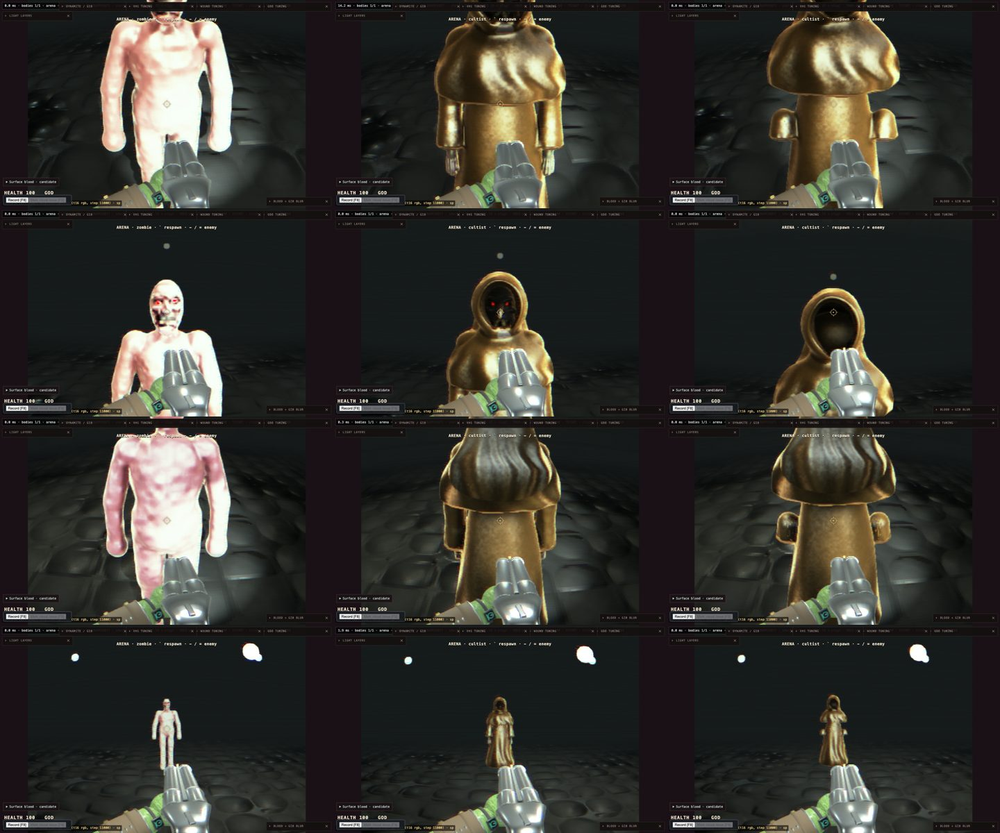

# A cloaked mesh skeleton: is it cheaper to draw than the cultist? (2026-10-27)

The question (owner): a new enemy, a detailed **mesh skeleton wearing a cloak**, with no blood. The player shreds the
cloth, then destroys the bones. Before anyone builds it: would it be cheaper to draw than the cultist (SDF flesh under
full SDF cloth)? Nothing here builds the enemy.

**Short answer: yes, by a lot.** But most of the saving is **not the cloth**.

| View (arena, one enemy) | Cultist (SDF body + SDF cloth) | SDF cloth only (stand-in for SDF cloth over a mesh skeleton) | Raster cloak + mesh skeleton |
| --- | --- | --- | --- |
| close-up, chest, front | **8.04x** | **1.34x** | ~0 march |
| close-up, head (the hood) | 8.30x | 1.77x | ~0 march |
| close-up, back | 5.41x | 1.23x | ~0 march |
| arena distance (6 m), front | **5.61x** | **1.02x** | ~0 march |

The figures are march prim evaluations (walk + shade) per frame, relative to a **bare zombie** at the same distance.
The "~0 march" column is an estimate, not a measurement.

- **The cultist is 5-8x a zombie, not the robe zombie's ~1.7-2x.** It is expensive because of its **flesh**, not its
  cloth. It folds **23 prims per march step** in close-up; the zombie folds 5.4. Its head cluster is 24 prims (the
  sculpted face: brow, sockets, eyes, nose, cheeks, chin, mouth, eight teeth, the face block, hood and peak), and
  each arm is 10 (five fingers). Every ray that comes near the hood folds that whole group.
- **The cloth alone costs about what a bare zombie costs.** It takes more steps (0.31M against 0.13M in close-up:
  thin sheets and silhouette rays), but only 3-4 prims per step. That is **1.0x at arena distance, 1.2-1.8x in
  close-up**.
- **A raster cloak costs the march nothing.** It is the cheapest option, by about another zombie per enemy in
  close-up. What it gives up is the SDF cloth's sheet behaviour (below).

## How it was measured

- **Tree:** PR goblincore/blud#86's branch (`claude/friendly-nobel-4ade75` at `1a0f8b82`). That
  branch has the cultist the owner described: the loose hood with `shroud=` and `ruffle=`, the drape and the cloth
  peak. It also has the analytic normals working again, so its bare zombie is cheaper than main's. Every ratio
  above compares runs on the same tree.
- **Method:** the counters from `docs/dev-notes/2026-10-26-sdf-cloth-cost/NOTES.md`. Debug mode 13 is the ray walk
  (misses included) and mode 14 the whole pixel, read off the float march target. **total = walk + shade.** The
  page is frozen and seeded. The counts are deterministic: the back view reproduced exactly across two boots.
- **Page:** `/sdf-game.html?level=arena&spawn=<character>&seed=1&loader=0&frozen=1`, 1280x800, as the arena ships
  (outer hulls, kit occluder).
- **Driver:** [`arena-cost.mjs`](arena-cost.mjs), a fork of `scripts/cloth-cost-game.mjs` for the arena's one enemy.
  It has four stages:
  - `close`: the eye 1.3 m in front of the chest;
  - `head`: the eye 1.3 m in front of the head;
  - `back`: the eye 1.3 m behind the chest;
  - `far`: the eye 6 m in front of the chest.
  - The arena enemy faces the opposite way to room 4's zombies, so its "front" sign is flipped.
- **Cloth-only variant:** [`cloth-only.mjs`](cloth-only.mjs) rewrites `cultist.blob`:
  - It keeps the skeleton and the six live cloth shells: hood, drape, peak, capelet, skirt and the two bell cuffs.
  - It drops every flesh prim and the `when=dead` hood-down set.
  - It drops the `face` block. Even so, `compileBlob` always appends the face block's four head prims, so the
    measurement also needed two **temporary, uncommitted** one-line patches on that tree:
    - `blob-compile.ts`: skip `facePrims` when the model name ends in `-clothonly`;
    - `game-main.ts`: `?clothonly` swaps `CHARACTERS.cultist.src` for the variant.
- **Raw data:** [`result.json`](result.json). The frames are below: rows close, head, back, far; columns zombie,
  cultist, cloth only. The gun covers the face in the head row, the same for all three.



## Numbers (prim evaluations per frame, M = million)

| Stage | Variant | Steps | Marched px | Walk | Shade | **Total** | x zombie | Prims/step |
| --- | --- | --- | --- | --- | --- | --- | --- | --- |
| close | zombie | 0.133 | 35,804 | 0.725 | 0.340 | **1.065** | 1.00 | 5.4 |
| close | cultist | 0.289 | 45,426 | 6.664 | 1.891 | **8.555** | 8.04 | 23.1 |
| close | cloth only | 0.311 | 45,474 | 1.167 | 0.258 | **1.425** | 1.34 | 3.8 |
| head | zombie | 0.078 | 21,492 | 0.402 | 0.207 | **0.609** | 1.00 | 5.1 |
| head | cultist | 0.175 | 25,620 | 4.052 | 1.006 | **5.058** | 8.30 | 23.1 |
| head | cloth only | 0.237 | 26,616 | 0.916 | 0.161 | **1.078** | 1.77 | 3.9 |
| back | zombie | 0.120 | 33,014 | 0.589 | 0.275 | **0.864** | 1.00 | 4.9 |
| back | cultist | 0.233 | 39,690 | 3.757 | 0.916 | **4.673** | 5.41 | 16.1 |
| back | cloth only | 0.237 | 40,508 | 0.854 | 0.210 | **1.064** | 1.23 | 3.6 |
| far | zombie | 0.008 | 1,928 | 0.040 | 0.020 | **0.059** | 1.00 | 5.3 |
| far | cultist | 0.015 | 2,700 | 0.264 | 0.068 | **0.332** | 5.61 | 18.0 |
| far | cloth only | 0.016 | 2,694 | 0.050 | 0.011 | **0.060** | 1.02 | 3.1 |

Reading it:

- **Steps** are the cloth's cost. The cultist and the cloth-only variant march the same pixels with about the same
  steps, both about twice the zombie's.
- **Prims per step** is the flesh's cost. Removing the flesh takes the cultist from 23 to under 4. That is the 6x.
- **The hood is the worst view for cloth only:** 8.9 steps per marched pixel, against 6.8 in the chest view. Rays
  that enter the opening find nothing inside and walk the empty hood. A real skull mesh in there would stop them
  (see the kit occluder, below), so this view overstates the skeleton's cost.
- **Timing was not taken.** The load average was 60-140 for the whole run. The counters are the result, as in the
  2026-10-26 note.

## Option 3: the cloak as a raster mesh

- **March cost: about zero.** A kit mesh is rasterised, so an enemy whose cloak and bones are both kit meshes has
  nothing to march. Its raster cost is a few thousand skinned triangles, small next to any marched body and
  separate from these counters. It was not measured.
- **Sway** would be a vertex shader on the kit material, weighted by height down the cloak and driven by the same
  eased spring the hood's lattice rides (`cloth-sway.ts`) and the `hem` pendulum. That is new code: kit materials
  have no vertex animation today. The kit is rigidly skinned, one bone per vertex, weight 1 (`blender-kit.ts`), so
  a skirt would also need the hem bone and a height-weighted blend down it to bend.
- **What it gives up:**
  - the hollow sheet you can see into (the hood's dark opening is `shroud=`, an SDF-shell feature);
  - `ruffle=`'s ragged, moving edge;
  - folds that are geometry rather than a normal map;
  - shredding by carving (below). A raster cloak shreds by **hiding triangle islands** instead.
- **Hit detection is the real cost of a mesh-only enemy.** Projectiles hit the **posed SDF prims**: a wound's
  `primIdx` gives its bone, and `hitPlate` keys armour by that bone (`game-actor.ts`). A body with no prims cannot be
  hit. It needs one of these:
  - **thin SDF `core` bars** inside the bones (the biomech pattern). They are drawn, but a kit occluder stops the
    march at the mesh. That costs some steps from the hull to the mesh, about what the cloth costs, unmeasured.
  - **CPU-only hit prims:** a new prim flag that the hit trace sees but `pack.ts` never uploads. That is zero GPU
    cost, but new engine work.

## Shredding the cloth (option 2: SDF shells over a mesh skeleton)

What exists:

- **`clothifyWound`** (`damage.ts`): a hit on cloth (a shell or a painted non-metal prim) is either a ragged `tear`
  (heavy round) or a 14 mm bullet `hole` (small calibre).
- **`clothDecal`**: the cultist is a **soft target**, so it overrides that. Its cloth takes **decals and never
  carves**: a stain capped at 7 cm, or a scorched hole.
- **A carving wound** cuts the blended body, cloth and flesh together. That is why holes in a carved body's shells
  are **flesh-sized craters**: the radius comes from the flesh wound profile (a slug is 0.16 m), not from the
  cloth. That is the open item from the 2026-10-26 note.

What shredding would need:

1. **A cloth wound profile.** Size the carve by calibre for cloth (a pellet a few centimetres, a slug about 8 cm),
   carve only through the sheet's thickness, with no lip (`rimScale = 0`, which holes already get) and the existing
   ragged edge. With nothing behind the sheet but a mesh skeleton, the carve shows the bones through the hole. No
   flesh-crater problem arises, because there is no flesh to crater.
2. **A wound budget.** `MAX_WOUNDS` is 32 per actor. A shotgun shredding a cloak reaches it in a few shots, and every
   wound near a ray is evaluated per step (applyWounds). It needs merging or eviction of old cloth holes, and the
   per-wound march cost should be counted with this driver before committing to it.
3. **Cheaper tattering first.** Most of the "shredded" read can come from parameters the shells already have, with
   no wounds at all:
   - raise a shell's clip plane (`clipd`) per hit, so the hem rides up;
   - raise its `ruffle=` amplitude, so the edge gets more ragged;
   - drop a whole shell when it is spent (the hood already swaps `when=alive` / `when=dead` sets).

   Each is a uniform change, not a new march cost. Carve holes only for the hits the player is looking at.
4. **Rounds must pass through the cloth to the bones.** Today the cloth is a hit surface like flesh. The trace has
   to report the cloth hit (for the hole) and carry on to the bone under it (for damage), at least once the cloth is
   spent.

## Destroying the bones (the Blender kit pipeline)

The pieces mostly exist:

- **Authoring:** `scripts/blender-kit.ts` compiles a Blender `.glb` to the kit glTF. Every mesh node is named
  `<bone>|<part>` and rides that `.blob` bone rigidly. A skeleton fits this well: skull, jaw, ribcage, pelvis, each
  long bone and each hand as its own part.
  - The biomech style sheet's look rules apply to the bones: sculpted, ridged, AO baked into vertex colours, wear as
    vertex colour.
  - The `.blob` keeps only the skeleton plus the cloth shells, so the kit has bones to ride.
- **Per-bone hit points and shedding:** `plate-armor.ts` + `webgpu/kit-damage.ts`.
  - Plates are keyed by `.blob` bone groups with hit points. A plate at zero **sheds**.
  - kit-damage hides that bone's **triangle islands** (by rewriting the index buffer) and spawns them as physics
    debris.
  - That is exactly "shoot the forearm off". Swap the juggernaut's "absorb the round" rule for "the round damages
    this bone", and give each bone group its own HP.
- **The kit occluder (`kit-occluder.ts`)** stops the march at opaque kit meshes. It lists eligible materials by name
  (`cloth`, `boot`, `leather`, ...). Add a **bone material** to that list and the SDF cloth's rays stop at the skull
  and ribs behind it: that is the hood's empty-interior cost above. A shed bone leaves the occluder for free (its
  twin draws the same hidden geometry).
- **Missing:**
  - the hit-detection prims (above), since kit meshes are not hit targets;
  - a "collapse" when the legs or spine go (the gait and `soft-death.ts` have the pieces);
  - a bone-chip/dust effect in place of blood.

## Recommendation

1. **Build the skeleton as kit mesh under SDF shell cloth (option 2).** Measured at **1.0x a zombie at arena
   distance and 1.2-1.8x in close-up**, against the cultist's 5.6x and 8.0x. It keeps what SDF cloth is good at (the
   shrouded hood opening, a ragged moving edge, cloth that can tear) and it fits the existing kit-shed pipeline for
   the bones.
2. **Shred by parameters first, carves second:** clip planes and `ruffle=` rising per hit, whole shells dropping
   when spent. Then add a cloth-sized carve profile and a wound budget for close-range holes. Measure those carves
   with `arena-cost.mjs` before committing to them.
3. **A raster cloak (option 3)** is the floor: zero march. Choose it only if a crowd of these must be cheap at close
   range. It costs a vertex-sway system the kit does not have and loses the hood's shroud.
4. **Whichever option:**
   - give the skeleton hit prims (thin `core` bars, or a CPU-only flag);
   - add a `bone` material to the kit occluder's allow-list;
   - re-measure with the real skull in the hood. It should land below the cloth-only head figure.
5. **Separately, the cultist itself is 5-8x a zombie**, and the cause is its 24-prim head and 10-prim hands under
   the cloth, not the cloth. Two ways to bring it near the robe zombie's ~2x:
   - move the face detail into a baked normal map (the biomech rule: detail as prims costs every pixel);
   - move the fingers to kit hands, as the zombie and goblin did.
   That is a separate task.

## Files

- [`arena-cost.mjs`](arena-cost.mjs): the arena census driver (needs a tree with `?clothonly` patched in for the
  third variant).
  ```bash
  bash -c 'export LAB_TMP=.lab-tmp LAB_VITE_PORT=5282 LAB_CDP_PORT=9282; . scripts/lab-servers.sh; trap lab_servers_down EXIT; lab_servers_up; DUMP=1 node docs/dev-notes/2026-10-27-skeleton-cloak-cost/arena-cost.mjs 5282 9282'
  ```
- [`cloth-only.mjs`](cloth-only.mjs): `cultist.blob` to the cloth-only variant.
- [`result.json`](result.json): the raw census.
