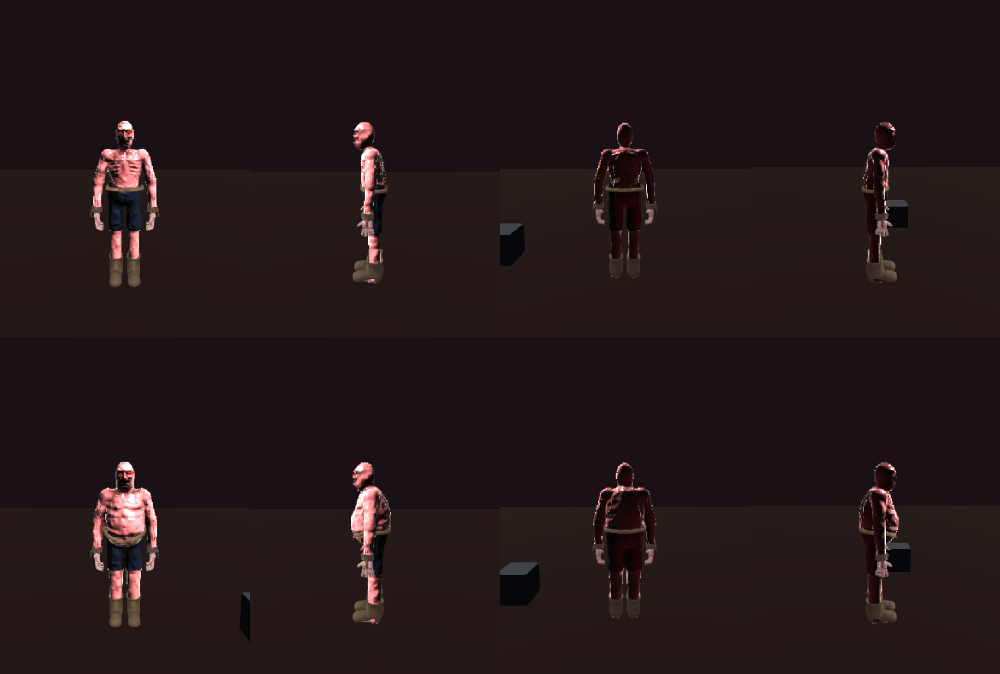
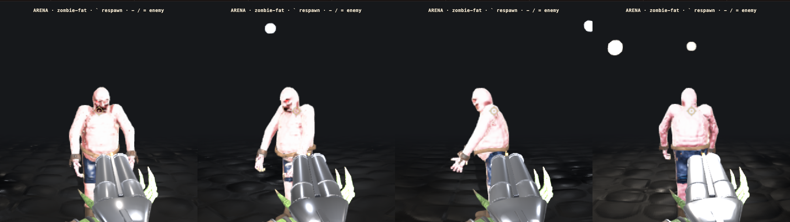
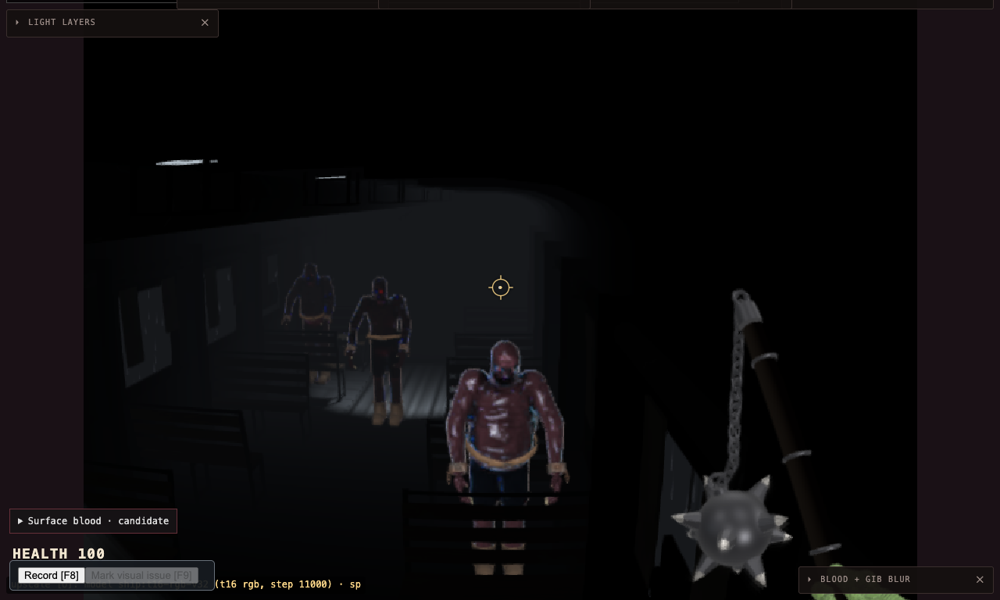

# The fat zombie (2026-10-27)

A second zombie body for crowds: the plain zombie (the rotting labourer, PR goblincore/blud#82) gone to fat. Built on
that branch's kit and pipeline, as its own character `zombie-fat`, and mixed in with the plain zombies wherever a level
spawns them.

## What it is

- **Body** (`src/lab/sdf-zombie/characters/zombie-fat.blob`): the zombie's skeleton and authored bones copied
  verbatim, so the shamble, the rig and the kit bones are unchanged. Flesh only is new: a front-heavy gut that hangs
  over the belt (one extra pelvis blob), bigger chest and belly masses, a neck as thick as the skull with a jowl roll
  under the jaw (one extra head prim), a rounder head and wider jaw in the `face` block, fat arms and thighs, heavier
  calves. The wrist stays the zombie's 0.040, so the shackles and grabber hands fit. 29 flesh prims against the
  zombie's 27.
- **Kit**: the zombie's labourer kit REFIT, not copied. `scripts/zombie-surface.ts zombie-fat` probes this body's posed
  skin into `assets-source/zombie-kit/surface-zombie-fat.json`; `make_kit.py -- labourer --body zombie-fat` lays the
  same hands, shackles, belt and boots on it. The belt's front dips 9 cm (`BELT_DIP`) so it runs under the gut instead
  of cinching it round the middle. 12.8k tris, the same five materials as the zombie's.
- **Body map**: `zombie-detail-gen.ts --fat` (on by default for `zombie-fat`): no collarbones, ribs, sternum, spine
  knuckles or shoulder blades show through; a crease under the gut, a navel rim, love handles, back rolls, a fold under
  each breast and stretch marks instead. The trousers and arm veins are the zombie's tables. Bake args in
  `bake-args.json` (`zombie-fat`: wider limb cylinders).
- **Plays as a zombie** (`CharacterEntry.kin: 'zombie'`, `isZombieKin`): the panel flesh, the generated face sheet,
  the slug head split, the decapitation rule and the head pop, which were keyed on the name `zombie`. Kit hands come off
  and the belt and shackles break off the same way. `ZOMBIE_FAT_PROFILE`: the shamble at 0.95 m/s (the zombie's 1.15).
- **Mixing** (`src/lab/sdf-zombie/zombie-variants.ts`): a `zombie` spawn slot becomes `zombie-fat` when a stable
  hash of its spawn id falls in the variant's share (25%). The same seats get the same bodies every load. Night Train:
  5 of 23 (`c1-sleeper`, `dancer-1`, `third-slumped-2`, `third-slumped-3`, `waiter-1`); The Wake: 5 of 20. Ring-level
  slots (`ring-<room>-<i>`) roll the same way. `?spawn=<character>` still overrides every zombie slot.

## Frames

`lab-zombie-vs-fat.png`: the lab turntable (`blob:shot`), the plain zombie above, the fat zombie below, front / side /
back / side.



`arena.png`: `/sdf-game.html?level=arena&spawn=zombie-fat`, front, 3/4, side, back.



`night-train-mix.png`: Night Train with no override, the second car looking down the aisle: a fat zombie in front, a
plain zombie behind him, the second fat one further down the car.



Captured with `scripts/zombie-fat-game-frames.mjs` (bride-game-frames for any level and character; `PICK` chooses
which actor, `SETTLE` waits out a story level's first pipeline compile).

## Budget

Each variant is one more crowd type per room it appears in (`game-crowd-types.ts` keys types by `character@room`), one
more kit glTF parse (shared by every fat zombie) and one more body map. That is why the share is a minority and there is
one variant, not several.

## Rebuild

```
npx tsx scripts/zombie-surface.ts zombie-fat
/opt/homebrew/bin/blender -b -noaudio -P assets-source/zombie-kit/make_kit.py -- labourer --body zombie-fat
npx tsx scripts/blender-kit.ts zombie-fat assets-source/zombie-kit/zombie-fat-parts.glb
npx tsx scripts/zombie-detail-gen.ts zombie-fat
npx tsx scripts/bake-body-normal.ts zombie-fat <the zombie-fat line of scripts/body-normal-bake/bake-args.json>
```

When #82's trousers change (SDF shell cloth), copy the change into `zombie-fat.blob` and rerun the five lines.

## Open

- The owner's look in game.
- If #82 replaces the painted trousers, the fat body follows (above).
