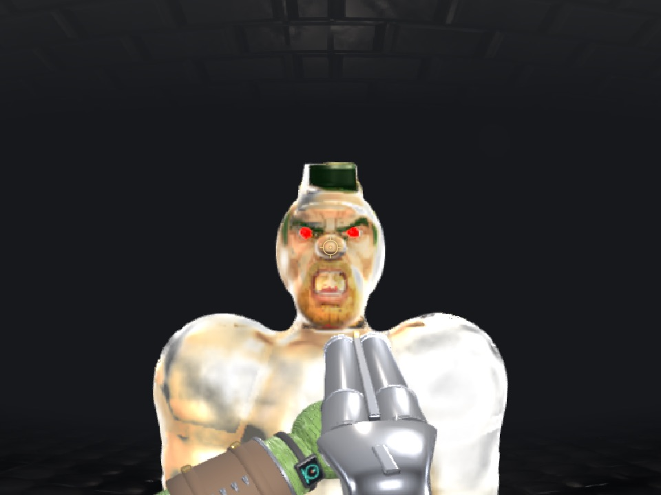
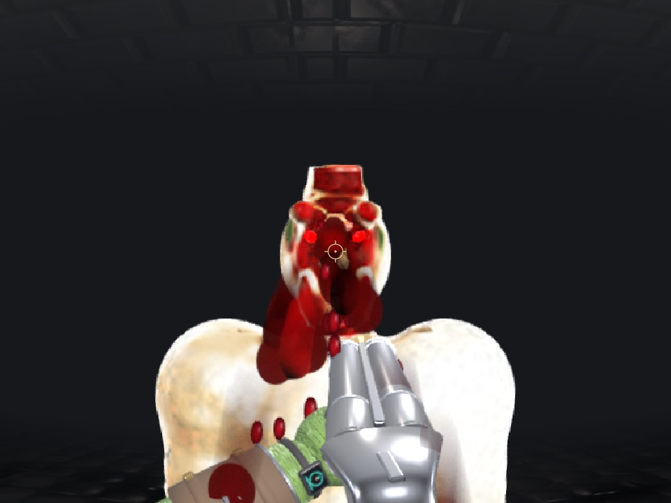
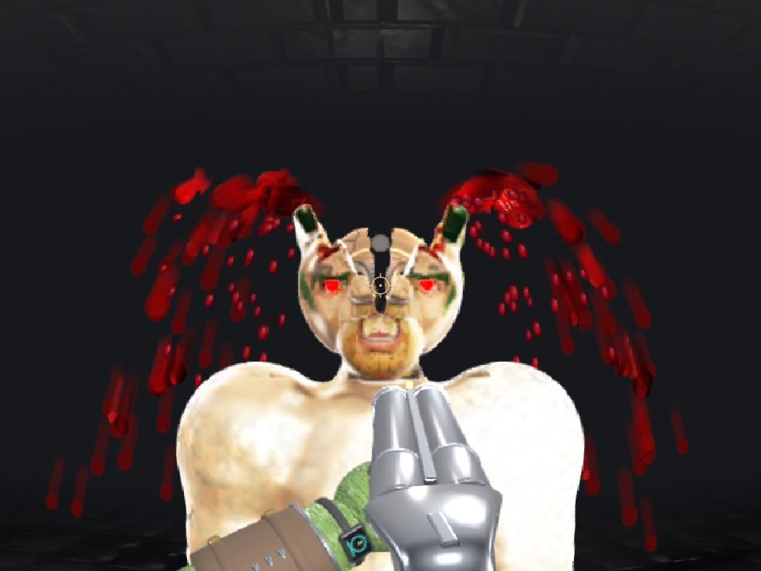
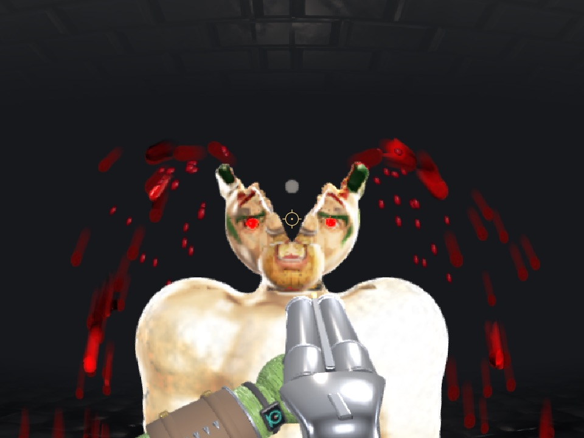
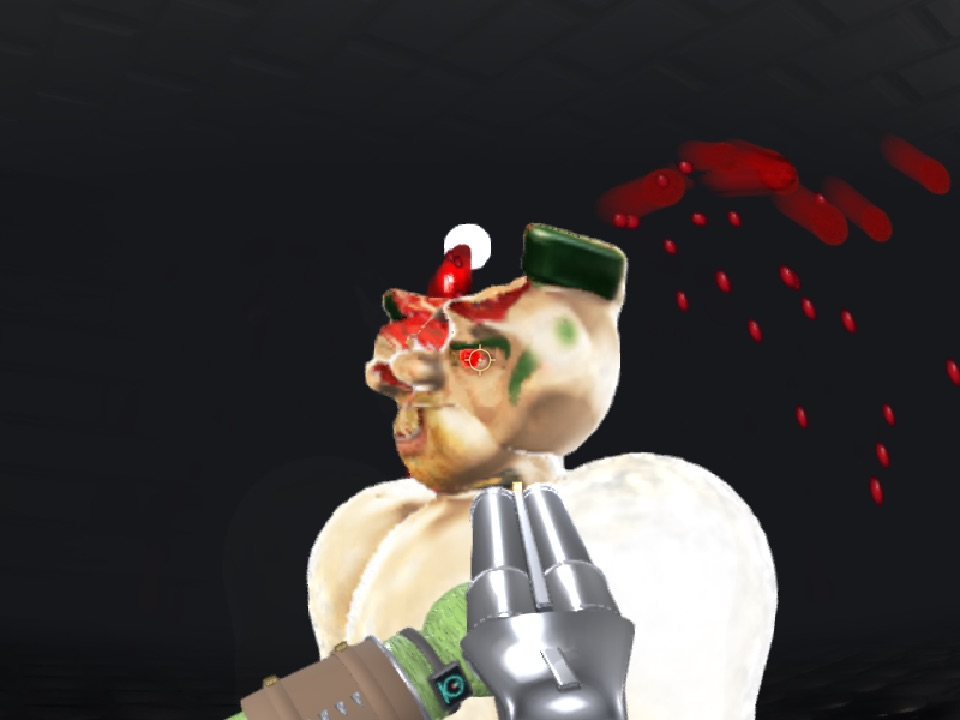
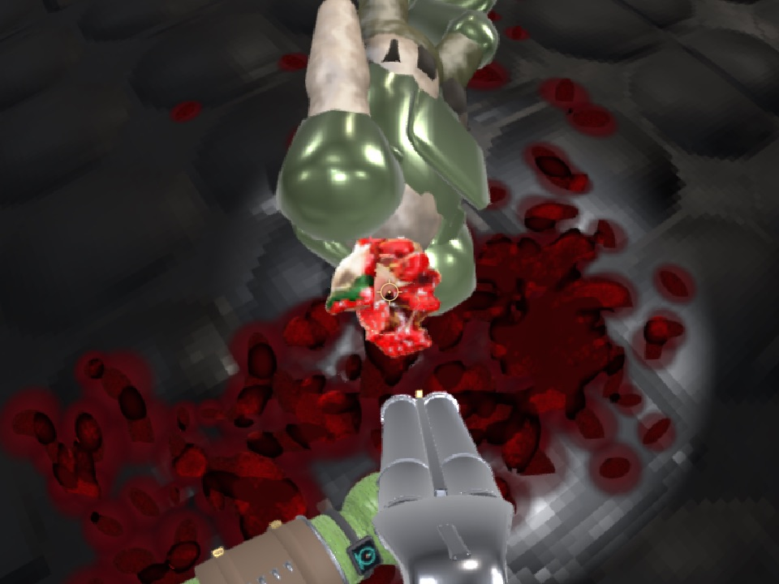
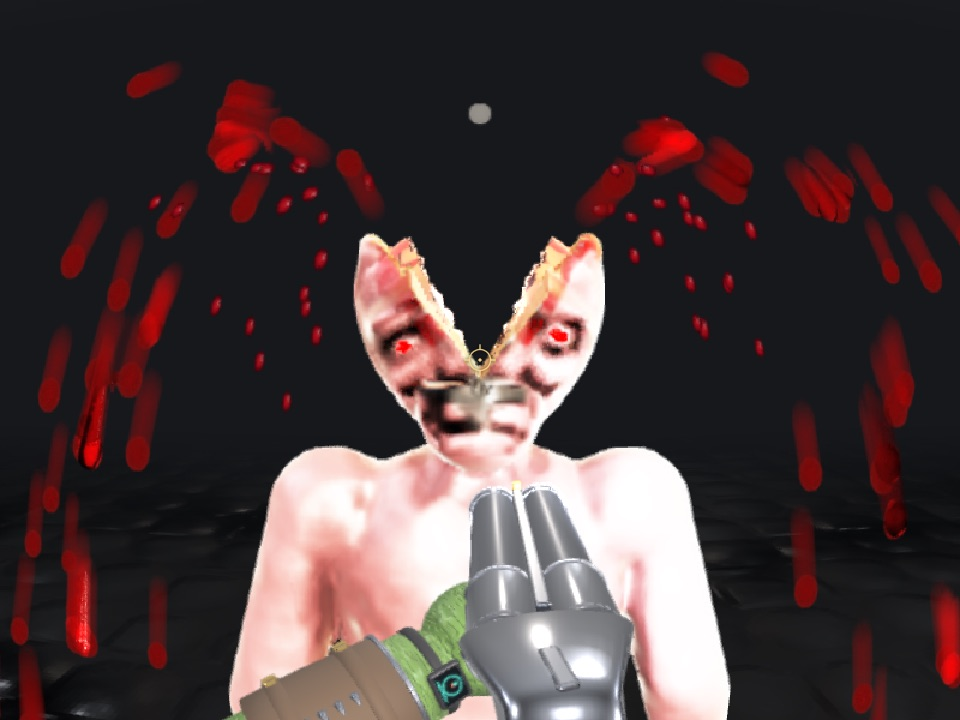

# Head split roll-out: the soldier, and what every other enemy needs

2026-11-02. The spike that took the zombie's head split (axe chops, the precise slug, the pop on a split-wide head) to
the soldier, and surveyed every registered character for the rest of the roll-out.

## What changed

- **One list, by character** (`head-split.ts SPLIT_HEADS`, `splitsHead`). The split leaf (`game-head-split.ts`
  `canSplit`), the slug's head shot (`game-head-shot.ts`) and the pop's wiring (`game-spawn.ts`, `onHeadPop`) all ask
  it. They used to ask `characterName() === 'zombie'`. It stays a character list: 13 characters move on the zombie's
  motion profile and the juggernaut and the warbull share the soldier's family, and none of them is on it.
- **A per-head hold** (`SPLIT_HEADS` `hold`, `HeadFrame.hold`). The presets' hinges are metres measured on the zombie.
  What turns with a half is the flesh above the hinge plane within rho of the hinge, with
  rho = |centre − h| + 1.25 × the skull's largest semi-axis × hold. The soldier's skull is smaller than the zombie's
  (0.103 m against 0.137) and his cap rises past that ball. At hold 1 the cap's crown stayed behind: two chips floated
  over his open head. At 1.1 nothing is left behind; he ships at 1.2, and nothing of his body rides off a half even
  at 1.6. `hold` widens the region sphere only, not the cut faces.
- **The soldier gets the pop** (`onHeadPop`). A slug on his split-wide head swells and bursts it, as it does the
  zombie's. His slug *decapitation* keeps the flying head; only the zombie's pops (`onDecapitate`).
- **The soldier lives with a split head**, as the zombie does. The axe's third chop kills him, as it kills everyone.

What did not need changing: his corpse bake. `soldier-corpse-bake.ts corpsePartition` spreads the pose, so the split
rides on the head that stays on the SDF path, and the settled, baked corpse keeps its open head (frame 4 below). His
face sheet follows the halves as the zombie's does. Not checked frame by frame: the skull mesh in the gap.

Tests: `head-split-fit.test.ts` (new: the heads on the list fit, by sampling at rest; the soldier needs his hold),
`head-split.test.ts` (the hold widens rho only), `webgpu/game-head-split.test.ts` (the soldier's axe split, the gap
on his skull), `webgpu/game-head-shot.test.ts` (his slug split, his pop, the juggernaut refused).

## Before / after (`npm run dev:arena`, `?spawn=soldier`)

Shot with [shoot.sh](2026-11-02-head-split-roll-out/shoot.sh) (headless WebGPU Chrome; the in-app browser pane does
not capture the WebGPU canvas): the frozen arena, `__sdfGame.axeChop(id, "H", "head")` twice, then the kill chop,
thawed and settled.

| | |
| --- | --- |
| Before, closed |  |
| Before, two head chops: two ordinary cuts, no split |  |
| After, chop 1: opened to the first stage |  |
| After, chop 2: split wide |  |
| After, from the side |  |
| After, the settled corpse (body baked to a mesh, head still SDF and still open) |  |
| Reference: the zombie, chop 2, same script |  |

The grey ball in the gap is the arena's lamp, in the zombie's frame too.

## Known gap on the soldier

**A slug that splits his head adds no injury.** A blast that is not an explosion's never reaches
`game-actor.ts recordSoldierInjury`. The split's faces come in as a blast, so the slug that opens his head adds nothing
to his regional tally, where an ordinary head slug adds 3 of the 12 that kill. The axe has no such gap: its chops were
never injury, and its third chop kills. Whether a split should kill a soldier outright is the owner's call; the spike
keeps the zombie's rule.

## What it takes for every other enemy

Adding a character is one line in `SPLIT_HEADS`, and `head-split-fit.test.ts` then measures it. Four things decide
whether that line is enough:

1. **Fit.** The head's own flesh must lie inside the hold ball (`left`), and none of the rest of the body
   (`dragged`). Measured at rest, under the zombie's hold, worst of `middle` both halves, `middle` one side either
   way, and `face`. Regenerate with `SPLIT_FIT_SURVEY=1 npx vitest run src/lab/sdf-zombie/head-split-fit.test.ts`.
   A small `left` is a `hold` bump, as the soldier's was. A large one, or any `dragged`, means the zombie's hinges do
   not fit that head. They are metres, so a head far from the zombie's size (R, the largest semi-axis, against
   0.137 m) also needs the presets scaled or its own presets.
2. **A kit on the head.** Kit meshes ride the skull bone rigidly and do not split. A helmet, hood, goggles or mesh
   teeth would stay whole over the open head. Each needs handling: shed it when the head opens (kit-damage already
   sheds plates), or split it with the halves. Found by reading each kit's skin weights for vertices on the skull.
3. **`headShape` must find the skull.** It takes the head cluster's largest prim. On a few bodies that is not the
   skull, and the frame is wrong.
4. **The damage model.** Gore bodies (the zombie's damage path) take it as the zombie does. The soldier's family needs
   the injury gap above. Soft targets (the cultists) die to their first hit and pop on a close head slug already.

| Character | Fit: left / dragged, R | Head kit | Status |
| --- | --- | --- | --- |
| zombie | 0 / 0, 1.00 | — | **works** (shipped) |
| soldier | 0.4% / 0 at hold 1, 0 at 1.2; 0.76 | — | **works** (this spike) |
| schoolgirl | 0 / 0, 0.74 | — | **needs a look** in the arena, then the line. Small head: check the hinge sits at the skull base |
| schoolgirl-alt | 0 / 0, 0.68 | — | **needs a look**, as schoolgirl |
| schoolgirl-described | 0.8% / 0, 0.67 | — | **needs a hold** bump (~1.1) and a look |
| bride | 0 / 0, 0.67 | (choker, on the neck) | **needs a look**. Her kit is armoured but nothing rides the skull |
| bonewalker | 0.2% / 0, 0.72 | — | **needs a hold** bump and a look |
| venus | 2.7% / 0, 0.66 | — | **needs a hold** bump and a look |
| ogre | 0.3% / 0, 1.12 | — | **needs a hold** bump and a look |
| broodmother | 3.8% / 0, 0.75 | — | **needs a hold** bump, and a check of her head frame (not a biped) |
| gutcrawler | 1.4% / 0, 0.64 | — | **needs a hold** bump, and a check of the head frame (a crawler) |
| goblin-home | 0 / 0, 1.31 | — | **needs scaled presets** (head 1.3× the zombie's), then a look |
| goblin | 0 / 0, 1.31 | goggles (lens, bridge) | **needs scaled presets + the goggles handled** |
| goblin-cinematic | 0 / 0, 1.00 | mesh teeth | **blocked by the kit teeth** (the mouth would not part) |
| goblin-cinematic-home | 0 / 0, 1.31 | mesh teeth (borrowed) | **blocked by the kit teeth**, and needs scaled presets |
| cyberdemon | 0 / 0, 1.28 | optic housing (small) | **needs the optic handled** and scaled presets |
| gamer | 0 / 0, 1.17 | headset (black, yellow, cable, led) | **blocked by the head kit** |
| butcher | 0 / 0, 1.00 | skullmetal, brass, cable | **blocked by the head kit** (the fit is the zombie's skull prim) |
| flayer | 0 / 0, 1.00 | skullmetal, led | **blocked by the head kit** |
| deadeye | 0 / 0, 1.00 | skullmetal, brass, cable, led | **blocked by the head kit** |
| juggernaut | 0 / 0, 0.87 | helmet, snout, lenses | **blocked by the helmet** (kit and armour plate `helmet`, 8 hp), and the soldier's injury gap |
| clown, clown-alt | 0 / 0, 2.02 | cap hood, nose (badge) | **blocked by the hood**, and the head is twice the zombie's: own presets |
| warbull | 4.6% / 0, 1.53 | — | **needs scaled presets** and a hold, and the soldier's injury gap |
| female | 17.8% / 0, 0.64 | — | **needs her own presets**: a sixth of her head stays behind (hair) |
| gargoyle | 5.9% / 0, 1.64 | — | **needs his own presets** (head 1.6×) |
| minotaur | 2.7% / 10%, 1.41 | — | **needs his own presets**: one-sided and face splits carry body flesh off |
| twinhead | 4.7% / 0, 0.72 | skullmetal, iron, brass, eyeglow, teeth | **blocked by the head kit**; and which of two heads splits |
| mouse | 25% / 0, 1.00 | — | **needs its own presets** (a quarter of the head stays behind: the ears) |
| gibbet | 10% / 4.4%, 0.68 | iron | **blocked by the head kit**, and its own presets |
| gorehound | 0 / 38%, 1.64 | skullmetal, chrome, iron, teeth | **blocked**: a quadruped's head, the body rides off, and the head kit |
| chair | 0 / 85% | skullmetal | **blocked**: the body rides off, and the head kit |
| gnasher | 0 / 192%, 1.71 | — | **blocked**: the head is merged with the body |
| bloatmaw | 26% / 64%, 2.25 | — | **blocked**: no head to split from the body |
| dragon | 69% / 0, 1.00 | — | **blocked**: `headShape` finds a skull-sized prim, not the dragon's head |
| cyclops | 100% / huge, 1.97 | — | **blocked by `headShape`**: it picks a flat prim (0.27 × 0.012 × 0.036 m) |
| teratoma | 0 / huge, 0.26 | — | **blocked by `headShape`**: it picks a 3.5 cm prim |
| cultist, cultist-cowled | 34–42% / 14–22% | (cloth hood, shell) | **blocked by the soft-target death** (dies to the first hit, pops already) and the cloth hood |
| strand-fixture, box-fixture, thin-fixture | — | — | test fixtures, not enemies |

Kit column: the kit's materials that have vertices skinned mostly to the skull or head bone (`*-kit.gltf`), or the
`.wam` parts on `bone=skull`. The soldier's kit has none: his cap is flesh, in the blob.

### Suggested order

1. The near-free ones: schoolgirl, schoolgirl-alt, bride. Add each to `SPLIT_HEADS`, run the fit test and
   `shoot.sh <tag> <name>`. Then the hold bumps: schoolgirl-described, bonewalker, venus, ogre.
2. Scale the presets by head size (a per-head `scale` beside `hold`, multiplying the hinge offsets) for goblin-home,
   warbull, gargoyle, cyberdemon.
3. The head-kit pass, once for every kit: shed or split skull-bound kit pieces when the head opens. That unblocks the
   butcher, flayer, deadeye, gamer, goblin, juggernaut and clowns.
4. Close the soldier family's injury gap before the juggernaut and the warbull.
5. Non-humanoid heads (gorehound, gnasher, chair, bloatmaw, dragon, cyclops, teratoma) need their own design, not
   this split.

## Overlap with the damage/ragdoll session

None in files: this spike touched neither `connectivity.ts`, `collapse.ts`, `actor.ts`, `rig-bind.ts` nor `sever.ts`.
Its one damage-path change is in `game-spawn.ts` (the soldier's `onHeadPop`). A soldier head popped by a slug goes
through the actor's `popHead`, not `sever.ts`, so the decapitated-head fix there does not touch it. Their head-pose
change in `rig-bind.ts` moves `headQuatOf`, which the split's frame is built from, so re-run the soldier tests in
`game-head-split.test.ts` after both land.
